# Apex3D — Recognise. Reconstruct. Create.

**P5: Intelligent Fine-Grained Vehicle Recognition and Analysis System**  
*Computer Vision Hackathon 2026*  
**Repository:** [https://github.com/sinchanaa23/Apex3D](https://github.com/sinchanaa23/Apex3D)

---

## Overview

Apex3D identifies the fine-grained make, model, and year of a vehicle in an uploaded photograph (196 Stanford Cars classes), extracts intermediate classical computer vision features (CLAHE, Canny, Contours, HOG, LBP, and Geometric analysis), retrieves verified CC-licensed reference viewpoints from Wikimedia Commons, and coordinates 3D mesh reconstruction with automated geometry validation.

---

## Screenshots and demo

**Demo video:** [`docs/demo/demo.mp4`](docs/demo/demo.mp4) is a screen recording of the full flow: upload, identity, references, 3D Studio and Research Lab. GitHub shows a download link for it rather than playing it inline.

### Landing page

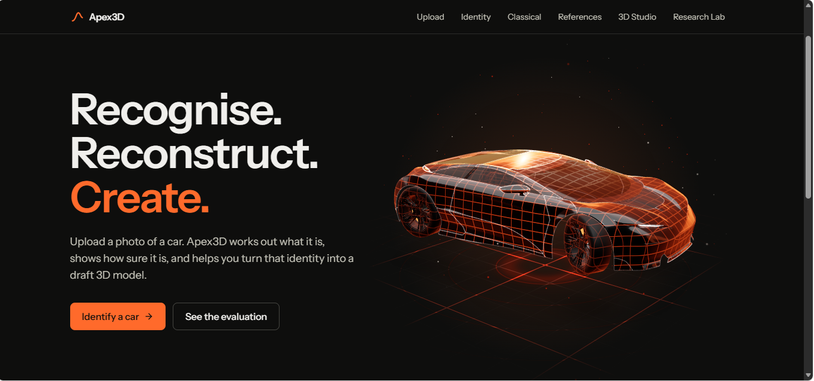

The headline, the two ways in (Identify a car, See the evaluation) and the 3D car that opens the app.

### Identity

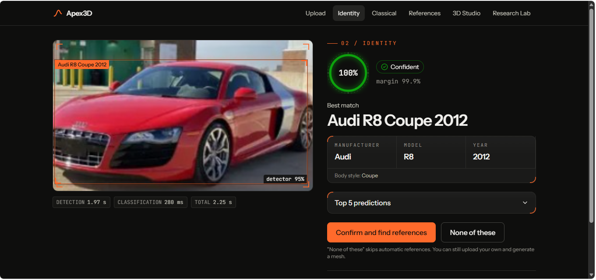

A red Audi R8. The detector box (95%) and the classifier's answer are drawn on the photo. The right side shows the confidence ring (100%, margin 99.9%, state Confident), the Manufacturer, Model and Year as separate fields, and buttons to confirm the match or reject it. Timings: detection 1.97 s, classification 280 ms, total 2.25 s.

### Identity: top 5 predictions

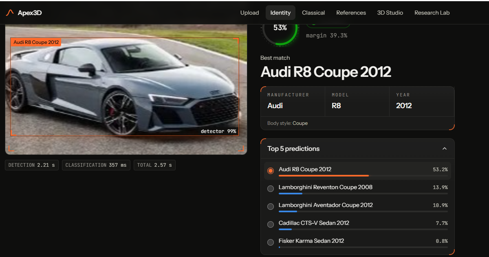

A second Audi R8 photo, a harder case. The model answers Audi R8 Coupe 2012 at 53.2% with a 39.3% lead over the runner-up, just above the app's 0.52 confidence threshold. The Top 5 list shows what it considered: two Lamborghini coupes (13.9% and 10.9%), then two sedans (7.7% and 0.8%). The detector found the car with 99% confidence. Timings: detection 2.21 s, classification 357 ms, total 2.57 s.

### References

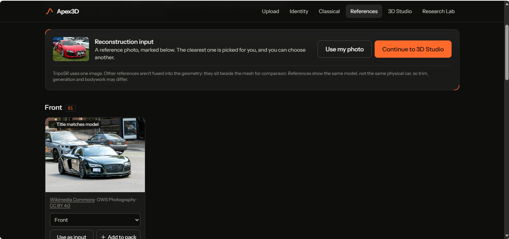

After the user confirms the car, the app lists reference photos of that exact model. Each shows its source and licence (here Wikimedia Commons, CC BY 4.0) and a 'Title matches model' flag. The clearest one is chosen as the input for 3D reconstruction, and the user can switch to their own photo.

### 3D Studio: showcase model

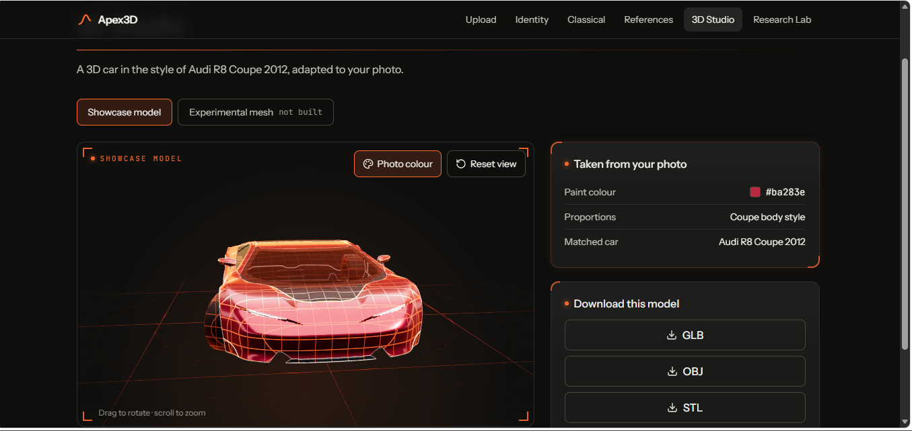

A 3D car in the style of the matched car, painted with the colour taken from the photo (#ba283e) and given coupe proportions. It downloads as GLB, OBJ or STL. The Experimental mesh tab says 'not built' until the user asks for it.

### 3D Studio: experimental mesh

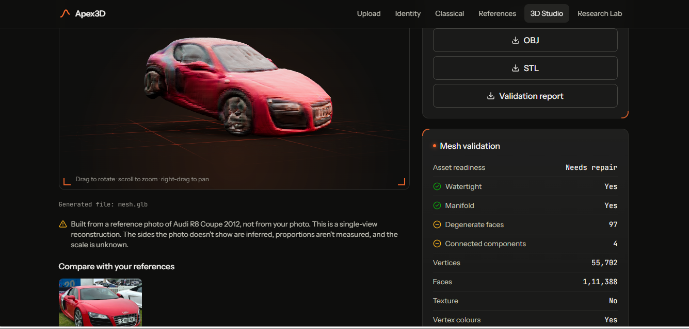

A rough mesh TripoSR rebuilt from one reference photo. The validation panel is measured on the file: watertight and manifold, but 97 degenerate faces and 4 connected components, so asset readiness is 'Needs repair'. The page warns that the unseen sides are inferred and the scale is unknown.

### Research Lab: robustness

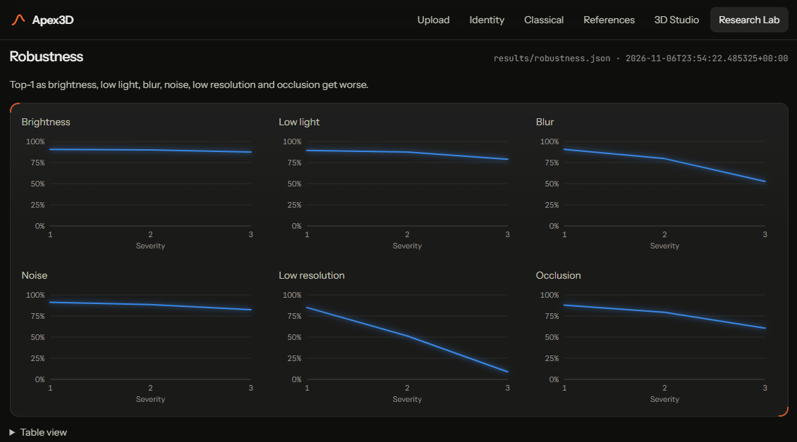

Top-1 of the deployed model at three severities of brightness, low light, blur, noise, low resolution and occlusion. Heavy blur, low resolution and large occlusion cost the most.

### Research Lab: confidence and rejection

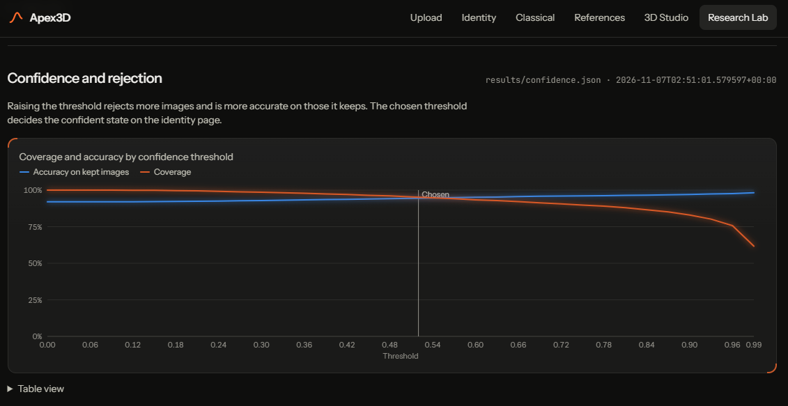

Raising the confidence threshold lowers coverage (orange) and raises accuracy on the images kept (blue). The vertical line is the threshold the app uses (0.52).

### Research Lab: classical vs deep vs hybrid

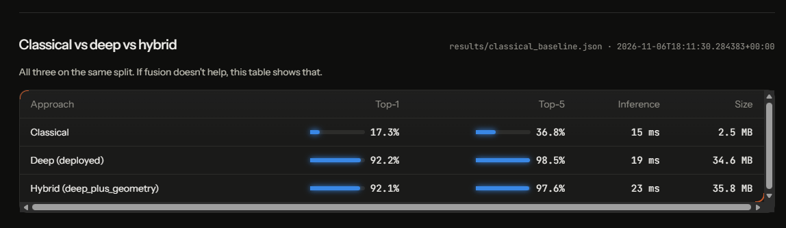

The three approaches on the same split, with Top-1, Top-5, inference time and size. Adding classical features to the deep model gave no gain.

### Research Lab: ablation study

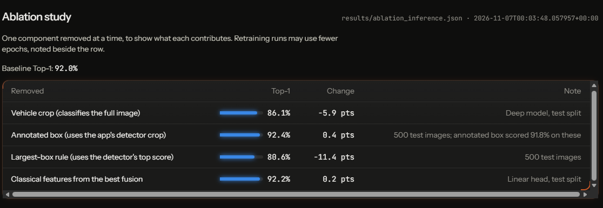

Each row removes or swaps one component of the pipeline and shows the Top-1 and the change against the baseline.

### Research Lab: failure cases

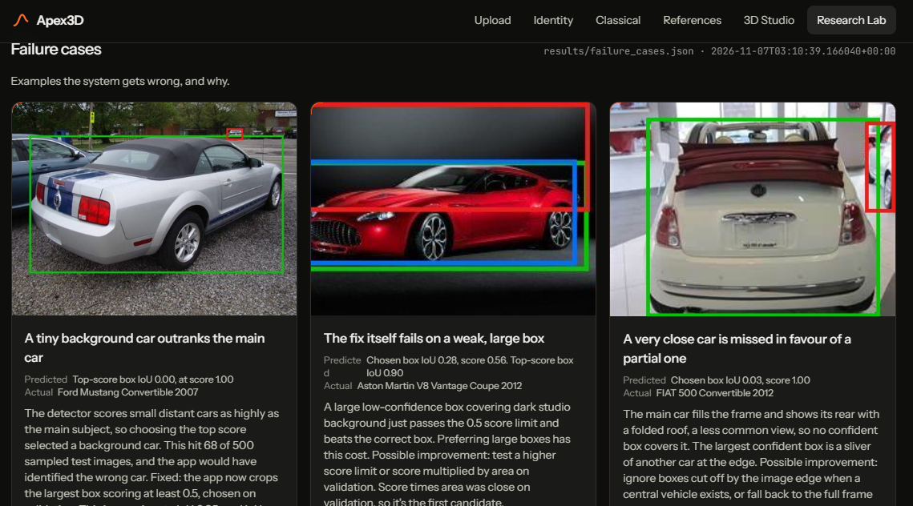

Research Lab, failure cases. Three detector failures with the photo, the box each method chose, and the cause: a tiny background car outranks the main Ford Mustang (top-score box IoU 0.00), a large low-confidence box beats the right box on an Aston Martin V8 Vantage (chosen box IoU 0.28), and a very close FIAT 500 seen from behind is missed in favour of a sliver of another car (IoU 0.03).

The evaluation report [`eval_P5_T25.md`](eval_P5_T25.md) uses the same screenshots next to the numbers they show.

---

## System Architecture

```
                       [React + Three.js Frontend]
                                    │
                                    ▼ (HTTP / REST)
                       [FastAPI Backend Service]
                       (Port 8000 / Tunnel Host)
                                    │
        ┌───────────────┬───────────┴───────────┬───────────────┐
        ▼               ▼                       ▼               ▼
 [Vehicle Detector] [Classifier]         [Classical CV]   [3D Queue Worker]
  Torchvision R-CNN  ConvNeXt-Tiny (196)  CLAHE, Canny,    SQLite Jobs DB
  + Heuristic Fallback + ONNX/PyTorch     HOG, LBP, Geo    TripoSR / Trimesh
                                                │               │
                                                ▼               ▼
                                         [Wikimedia API]  [Asset Exporter]
                                         CC-BY Retrieval  GLB, OBJ, STL
```

---

## Quickstart (One Command)

### 1. Requirements & Setup

- Python 3.12 or 3.13
- Install dependencies:

```bash
pip install -r requirements.txt
# Or run with existing environment:
python start_server.py
```

### 2. Start the Backend

```bash
python start_server.py
```

- **Interactive API Documentation (Swagger UI):** [http://localhost:8000/docs](http://localhost:8000/docs)
- **ReDoc Documentation:** [http://localhost:8000/redoc](http://localhost:8000/redoc)
- **Health Check:** [http://localhost:8000/api/health](http://localhost:8000/api/health)

---

## Running the full app (model, 3D reconstruction, frontend)

Step-by-step guide: [docs/RUN_FULL_APP.md](docs/RUN_FULL_APP.md). In short:

1. Put Person A's `model_quantized.onnx` in `checkpoints/` (not in Git, ask Person A for the file).
2. `scripts\setup_triposr.ps1` (or clone TripoSR to a short path and set `APEX3D_TRIPOSR_DIR`), then `pip install -r requirements-ml.txt`. The TripoSR weights (about 1.7 GB, `stabilityai/TripoSR`) download on first use.
3. `cd frontend && npm install && npm run build`, then `python start_server.py` and open http://localhost:8000.

## Development log (Person D)

Newest first. Each stage of the frontend and integration work is added here.

- **Architecture, design doc and retention (done):** `docs/ARCHITECTURE.md` was rewritten to match the code (it still said only the frontend existed), with the system diagram and the photo sequence rendered to `docs/architecture_system.{svg,png}` and `docs/architecture_sequence.{svg,png}` by `python scripts/render_diagrams.py`. `docs/DESIGN.md` now has Limitations and Ethics sections whose numbers all come from `results/`. Writing them found a real problem: nothing ever ran the storage cleanup, so uploaded photos (38 on the dev laptop) stayed on disk indefinitely. The server now deletes uploaded photos, user-uploaded references and old results automatically after `APEX3D_RETENTION_HOURS` (default 2), at start-up and every 15 minutes, keeping photos that a queued or running job still needs (`tests/test_retention.py`). The upload page's privacy sentence was corrected to match. The landing page still says photos are "deleted after processing", which is not exactly true for 3D builds; that wording is the team's call.
- **Report tooling (done; the report itself is for the team to write):** the hackathon's report template requires a PDF and limits AI-written content to 30% with AI help declared, so these tools write no explanation. `python scripts/build_report_facts.py` writes `report/FACTS_SHEET.md` (measured facts with their source files, the repository modules to cite, the figures that exist) and creates `report/report_P5_T25.md` with the template's headings, every explanation left as a `[WRITE: ...]` slot and the numeric tables filled from `results/` between `<!-- AUTO -->` markers (re-running refreshes only those tables, never the team's text). `python scripts/build_report_pdf.py` checks the report against the template (unfinished slots, missing sections, pasted code, percentages that appear in no result file) and renders `report/report_P5_T25.pdf` with Edge or Chrome in headless mode. `tests/test_report_tools.py` (8 tests).
- **Hugging Face Spaces deployment (prepared, not yet uploaded):** Render's free plan has 512 MB of memory, too little for the 3D mesh builder (about 1.25 GB), and a paid plan needs a card, so a Hugging Face Space (about 16 GB of memory) was prepared, but **Hugging Face answers 402: Docker Spaces need a paid PRO subscription**, so it is not free either (this was found when the upload was tried; nothing was created there). `deploy/huggingface/Dockerfile` runs as user 1000 on port 7860 with TripoSR and all weights baked in, and `python scripts/make_hf_space.py --upload USER/apex3d` builds a clean 42 MB folder with the README header Spaces needs and uploads it (the token comes from your own `HF_TOKEN`). `render.yaml` is set to the free plan with its limits written next to it. Use the direct `.hf.space` address, because login cookies don't work inside the huggingface.co frame. Accounts reset when a free Space restarts. Guide: `docs/DEPLOY_HUGGINGFACE.md`. `tests/test_hf_space.py` (3 tests) checks the folder and header. Not run on Hugging Face yet.
- **Render deployment files (done, not yet deployed):** `Dockerfile` (builds the React app and runs the server in one container, CPU-only PyTorch, detector weights fetched at build time), `render.yaml` (a Blueprint: one web service, a 1 GB persistent disk for accounts, health check `/api/health`, login required, API docs hidden) and `.dockerignore`. The step-by-step guide, the cost reasoning and what does not work online are in `docs/DEPLOY_RENDER.md`. Measured: the server uses about 330 MB after a few recognitions. TripoSR (the mesh builder) and its weights are baked into the image, so "Build experimental mesh" works online too. Measured here on the real code: a mesh takes about 4.8 minutes with 2 CPU threads (4.1 minutes with 16) and the whole server peaks near 1.25 GB, so the Blueprint asks for the 2 GB plan. `onnxruntime` was missing from `requirements.txt` and is now listed. The Docker image was not test-built locally, so the first Render build is its first real test.
- **Login and sign-up (done):** the app now has accounts. `/login` and `/signup` are real pages (inline validation, password strength meter, show/hide password, clear server errors), and the header shows Log in / Sign up, or the user's name and Log out. The server side is `backend/auth.py`: passwords are hashed with scrypt and a random salt, sessions are random tokens stored only as SHA-256 hashes and sent in an HttpOnly, SameSite=Lax cookie (Secure over HTTPS) that lasts 7 days, failed logins are limited to 5 per email per 10 minutes, and sign-ups to 30 per hour. Nothing in the app can be seen without a login: logged-out visitors get only the login and sign-up pages (the landing page, Upload, Identity, Classical, References, 3D Studio and Research Lab all redirect there, and the header links are hidden). The API follows the same rule: every route needs a login except `/api/auth/*` and `/api/health`, and so do the saved result files (`/results/*`) and the 3D models (`/models/*`). Only the app's own scripts and styles are public, because the login page has to load them. CORS no longer allows every origin (that combined with login cookies would let any website read a logged-in user's responses). Set `APEX3D_REQUIRE_LOGIN=0` to turn the requirement off for local work, and `APEX3D_CORS_ORIGINS` to allow extra origins. Accounts live in `backend/storage/apex3d.db` (not committed). Tests: `tests/test_auth.py` (15) and `frontend/src/lib/validate.test.ts`. Not built: password reset and email verification, because there is no email service. Anyone can sign up with any email address.
- **P5 rubric gaps closed on real data (done):** the deployed ONNX model was evaluated on all 8,041 Stanford Cars test images (`scripts/evaluate_deployed_model.py`; top-1 92.02% on the full run, within 0.2 points of Person A's published 92.20%). New results in `results/`: `robustness.json` (6 corruptions at 3 levels on a 1,000-image sample), `hybrid.json` (classical features fused with deep features; it did **not** help: 92.18% deep alone vs 92.09% fused), `confidence.json` (coverage-vs-accuracy sweep), `out_of_taxonomy.json` (`scripts/evaluate_out_of_taxonomy.py`: 91.5% of other vehicles and 98.3% of other things are rejected, AUROC 0.977, on Caltech-101), and `ablation_inference.json`. Six classifier failure cases with causes are in `docs/CLASSIFIER_FAILURES.md` (`scripts/build_classifier_failures.py`). `eval_P5_T25.md` is the comparative-evaluation file, generated by `scripts/build_eval_report.py --team T25 --usns ...`. The Identity page now shows Manufacturer, Model and Year as separate fields, and the Research Lab shows the hybrid comparison and the out-of-taxonomy table. Person B's `build_app_metrics.py` and `build_eval_report.py` were extended (not replaced) to include these sections.
- **Backend leftovers fixed (done):** `/api/recognize` now returns `503` with a clear message when no trained model is loaded, instead of invented predictions (the image-feature fallback is removed). `/api/reconstruct` no longer fetches web addresses on the server (`image_url` returns `400`). `tests/test_api.py` was brought up to date: it stubs TripoSR so the job queue test runs in seconds, checks that failures are reported and not replaced, and skips real recognition when the model file is absent. `docs/API_CONTRACT.md` notes each change.
- **Showcase on every job page (done):** the page for a reconstruction job (`/studio/<job id>`) opens on the showcase car, with tabs to switch to the experimental TripoSR mesh or catalog model. The car is there while the mesh is still building, and on old links. `GET /api/jobs/{id}` now also returns `class_name`, so the car's body style is known even after a page reload.
- **Showcase covers all 196 classes (done):** every Stanford Cars class maps to a body style (sedan, coupe, SUV, hatchback, wagon, van or pickup), including the 14 labels that name a trim instead, such as "Corvette ZR1" or "Challenger SRT8". A test (`frontend/src/lib/adapt.test.ts`) checks all 196 names against `results/class_names.json`, so a new or renamed class cannot silently fall back to the default shape.
- **Showcase car in the 3D Studio (done):** single-photo reconstruction (TripoSR) cannot give a clean car structure, so the Studio now opens on a designed showcase car instead: the landing page's Car Concept model (Khronos, CC BY 4.0, credited on the page) with the same contour-grid look. It is adapted to the user's photo in two measured ways only: paint colour, read from the car in the photo in the browser (`frontend/src/lib/adapt.ts`), and body proportions from the confirmed Stanford Cars body style. The page says plainly that it is not a 3D copy of their car. The adapted car is the Studio's deliverable: GLB, OBJ and STL downloads are written in the browser (`frontend/src/lib/exportCar.ts`) with the photo colour and proportions applied. The TripoSR mesh is still available as "Build experimental mesh", and its page has a back link to the showcase.
- **Better meshes for matched cars (done):** once the user confirms a car, the References page picks the clearest reference photo of that exact model (a three-quarter or side view whose title matches) and the Studio builds the mesh from it. The finished mesh is cached per car (`backend/storage/mesh_cache/<class_id>/`), so the next request for the same car is instant. Licensed models in `catalog/<class_id>.glb` are shown instantly, labelled "Catalog model". The Studio always says what the mesh came from: catalog model, reference photo of the matched car, or the user's own photo. `POST /api/reconstruct` takes two new optional fields, `class_id` and `source`, and `GET /api/jobs/{id}` returns `mesh_source`.
- **3D Studio restyle and real TripoSR meshes (done):** TripoSR is installed and the website generates real meshes from photos (about 3 minutes per car on CPU, first run also downloads about 1.7 GB of weights and a 176 MB background-removal model). The mesh viewer now uses the landing page's look: dark glossy body, orange contour grid that follows the mesh, scan sweep and pulse, white edge lines, glowing floor, slow turntable that pauses while dragging. A toggle shows the mesh's original colours. Meshes with no normals get them computed on load. Photo quality matters: a clean side or three-quarter photo gives a car-shaped mesh, while open doors or busy backgrounds give lumpy results.
- **Fake 3D fallback removed:** `backend/services/reconstruction_service.py` no longer invents a box-shaped car when TripoSR fails. The job fails with a clear error instead. Background removal now happens once, inside `backend/reconstruction`.
- **Person A's model connected:** classifier loads `checkpoints/model_quantized.onnx`. Class names come from `results/class_names.json`, and the default thresholds are the validated 0.52 / 0.34.
- **Person B's work connected:** `/api/classical` returns Person B's 10-stage pipeline. The Research Lab reads `eval_P5_metrics.json` plus Person A's `results/*.json`.
- **Frontend:** React 19 + Vite + Tailwind, landing page with a 3D hero, HUD-style inner pages, upload on the page, Research Lab with real numbers. Tests: `cd frontend && npx vitest run`.

---

## API Endpoints Summary

Full specifications and schemas are in [docs/API_CONTRACT.md](docs/API_CONTRACT.md).

| Method | Endpoint | Description |
|---|---|---|
| `POST` | `/api/recognize` | Vehicle detection, crop extraction, Top-5 prediction, confidence state |
| `POST` | `/api/classical` | CLAHE, Canny, contours, ROI, HOG, LBP, and geometric descriptors |
| `GET` | `/api/references?class_id=...` | Wikimedia Commons CC-licensed references with deduplication |
| `POST` | `/api/references/upload` | User reference photo upload |
| `POST` | `/api/reconstruct` | Enqueue background 3D reconstruction job |
| `GET` | `/api/jobs/{id}` | Real-time status, execution stage, logs, and progress |
| `GET` | `/api/assets/{id}/{file}` | Download generated GLB, OBJ, STL meshes and validation JSON |
| `GET` | `/api/metrics` | Saved offline notebook evaluation results (honesty principle) |
| `GET` | `/api/health` | GPU availability and queue status |

---

## Team Integration & Handovers

- **Person A (ML & Compute):**
  - Place fine-tuned checkpoint (`checkpoint.pth`, `best_model.pth`, or `model.onnx`) in `checkpoints/`. The classifier service auto-detects and loads it without code modification.
  - Export `reconstruct(image) -> trimesh.Trimesh` in `backend/reconstruction/`. The 3D worker dynamically hooks into it.
  - Save training metrics in `notebooks/metrics.json`.
- **Person B (Classical CV & Evaluation):**
  - Place custom classical CV algorithms in `backend/classical_cv/`.
  - Save evaluation and comparison results in `eval_P5_metrics.json`.
- **Person C (Backend & Retrieval - Current Role):**
  - FastAPI service, background job queue, SQLite persistence, trimesh validation & multi-format export, Wikimedia Commons retrieval.
- **Person D (Frontend):**
  - Connect your Vite/React app to `http://localhost:8000/api`.
  - For single-command production hosting, run `npm run build` inside `frontend/`. The backend will automatically serve `frontend/dist` on the root URL!

---

## Running Automated Tests

Run the end-to-end integration test suite:

```bash
python -m pytest -v tests/test_api.py
```

