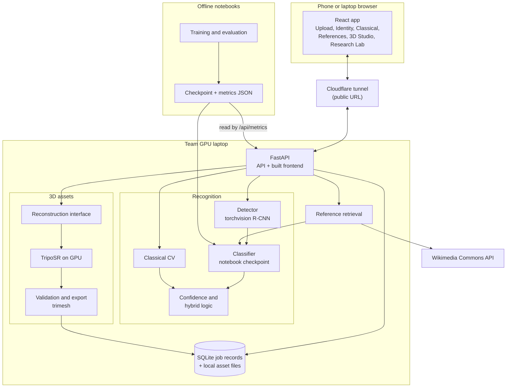
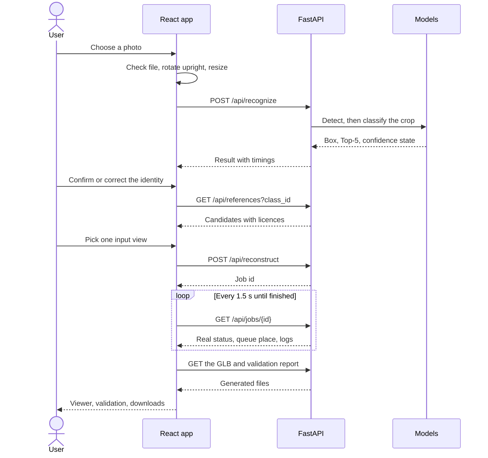

# Apex3D architecture

**Status: planned design.** Only the frontend exists so far. The backend parts are taken from the project proposal and should be updated if the build differs.

## System

FastAPI serves both the API and the built frontend, so one tunnel exposes the whole app.

## Which page uses which endpoint

| Page | Route | Endpoint | Shows |
|---|---|---|---|
| Home | `/` | None | What the app does and its limits |
| Upload | `/upload` | `POST /api/recognize` | File checks, preview, elapsed time |
| Vehicle Identity | `/identity` | Result of the upload | Box, confidence state, Top-5, correction |
| Classical CV | `/classical` | `POST /api/classical` | Intermediate images and features |
| Reference Studio | `/references` | `GET /api/references`, `POST /api/references/upload` | References by viewpoint, licence, input choice |
| 3D Studio | `/studio`, `/studio/:jobId` | `POST /api/reconstruct`, `GET /api/jobs/{id}`, `GET /api/assets/{id}/{file}` | Queue, logs, viewer, validation, downloads |
| Research Lab | `/lab` | `GET /api/metrics` | Saved notebook results, or "not available" |

## How a photo moves through the app

