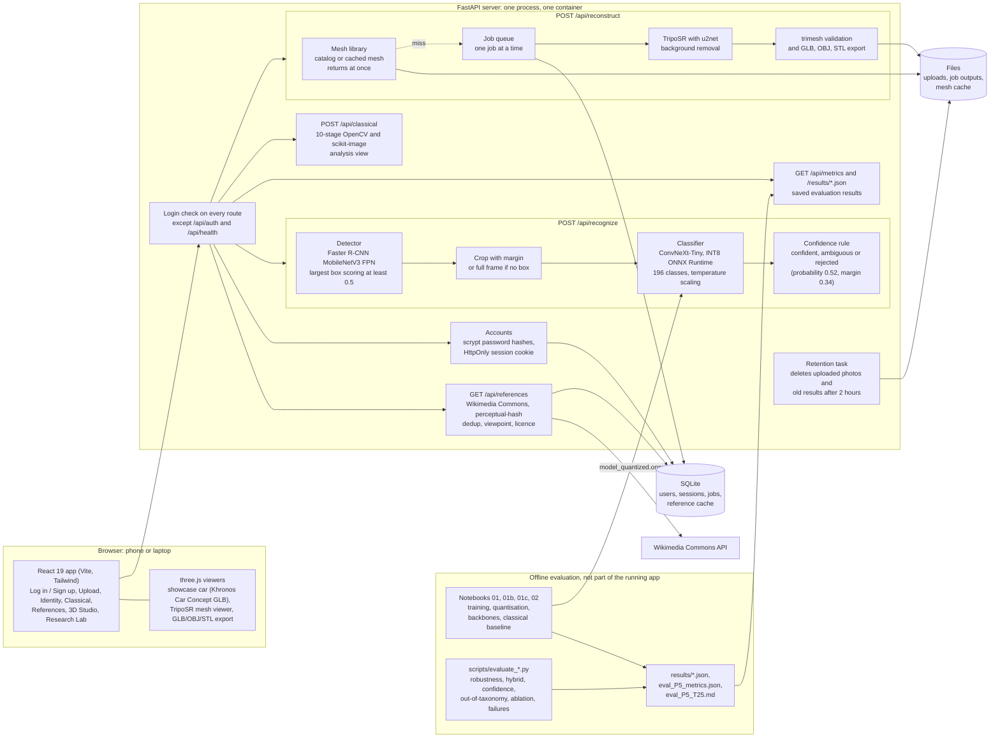
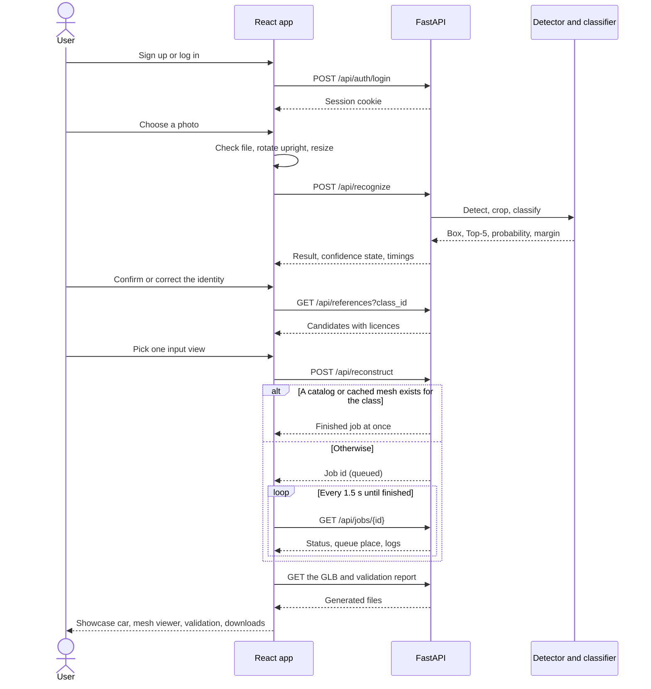

# Apex3D architecture

**Status: describes the code as built** (checked against `backend/`, `frontend/src/` and `Dockerfile` at the commit shown in the report). The app runs locally and has a Docker image; it is deployed on Render's free plan at https://apex3d-xvuc.onrender.com. Numbers quoted here come from `results/` and `eval_P5_T25.md`.

## System

The deployed model file is `checkpoints/model_quantized.onnx`, produced by notebook `01b` from the model trained in `01`. The server serves the built React app as well as the API, so one address exposes the whole application.

## What the live recognition path does, and what it does not

The live path is **detector, crop, classifier, confidence rule**. The classical stages run in their own endpoint (`/api/classical`) so users can inspect them, and the same classical features are the baseline in the evaluation. Fusing classical geometry features with the deep embedding was tested (`results/hybrid.json`) and did not improve accuracy (92.18% deep only, 92.09% fused on test), so the fusion is **not** in the production path. The report states this plainly rather than presenting the fusion as a gain.

## Which page uses which endpoint

| Page | Route | Endpoint | Shows |
|---|---|---|---|
| Log in, Sign up | `/login`, `/signup` | `POST /api/auth/login`, `POST /api/auth/signup`, `GET /api/auth/me`, `POST /api/auth/logout` | Account forms, session state |
| Home | `/` | None | What the app does and its limits |
| Upload | `/upload` | `POST /api/recognize` | File checks, preview, elapsed time |
| Vehicle Identity | `/identity` | Result of the upload | Box, Manufacturer, Model, Year, confidence state, Top-5, correction |
| Classical CV | `/classical` | `POST /api/classical` | Intermediate images and features |
| Reference Studio | `/references` | `GET /api/references`, `POST /api/references/upload` | References by viewpoint, licence, input choice |
| 3D Studio | `/studio`, `/studio/:jobId` | `POST /api/reconstruct`, `GET /api/jobs/{id}`, `GET /api/assets/{id}/{file}` | Showcase model, queue, logs, mesh viewer, validation, downloads |
| Research Lab | `/lab` | `GET /api/metrics`, `/results/*.json` | Saved evaluation results, or "not available" |

Every route above except the login pages and the landing page (`/`, with the showcase car it loads from `/models/`) needs a logged-in user. `GET /api/health` is the only other public API route.

## How a photo moves through the app

## Data the server keeps

| What | Where | How long |
|---|---|---|
| Accounts: name, email, scrypt password hash | SQLite `users` | Until deleted by hand |
| Sessions: SHA-256 of the cookie token | SQLite `sessions` | 7 days, then ignored and removed at the next login |
| Photos sent to `/api/recognize` | Memory only | Not written to disk |
| Photos sent to `/api/reconstruct`, and photos a user uploads as a reference | `backend/storage/uploads/`, `backend/storage/references/upload_*` | Deleted automatically after `APEX3D_RETENTION_HOURS` (default 2), checked at start-up and every 15 minutes. A photo needed by a queued or running job is kept until the job ends. |
| Finished meshes and validation reports | `backend/storage/jobs/` | Same retention |
| Job records (status, logs) | SQLite `jobs` | Kept; the files they point at are removed |
| Reference images fetched from Wikimedia Commons, and meshes cached per class | `backend/storage/references/`, `backend/storage/mesh_cache/` | Kept (not user photos) |

## Deployment

| Piece | State |
|---|---|
| `Dockerfile` | The lean image Render builds: the frontend and a server without PyTorch (the detector is exported to ONNX during the build). `deploy/Dockerfile.full` adds TripoSR |
| `render.yaml` | Render Blueprint on the free plan. The server needs about 260 MB, so it fits; the mesh builder does not (see `docs/DEPLOY_RENDER.md`) |
| `deploy/huggingface/` | Hugging Face Space version. Docker Spaces need a paid subscription (see `docs/DEPLOY_HUGGINGFACE.md`) |
| Laptop and tunnel | `scripts/run_tunnel.ps1` exposes the local server through a Cloudflare quick tunnel |
| Public URL | https://apex3d-xvuc.onrender.com (Render free plan: no disk, so accounts reset on restart; sleeps when idle; no mesh builder) |
