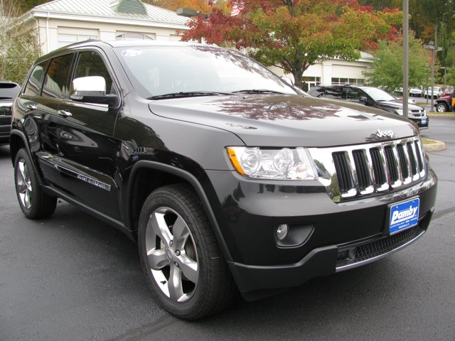
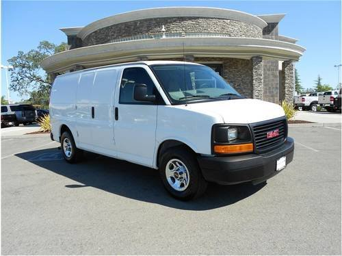
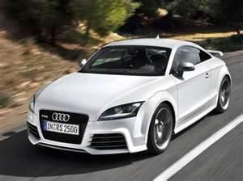
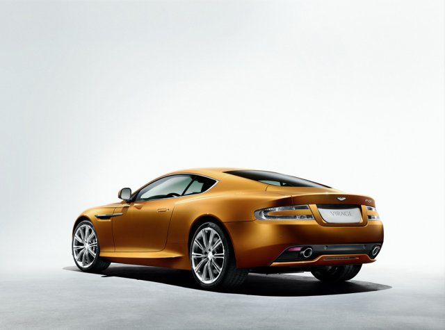
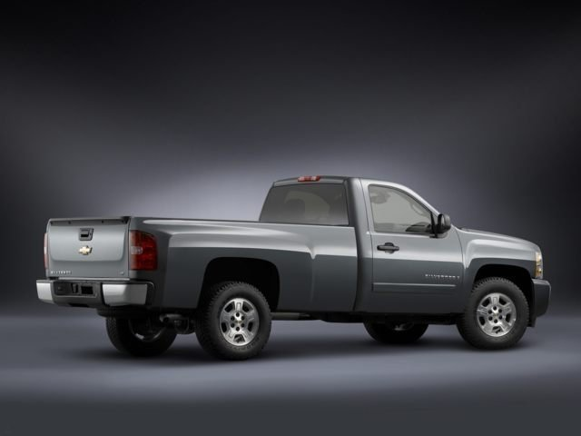
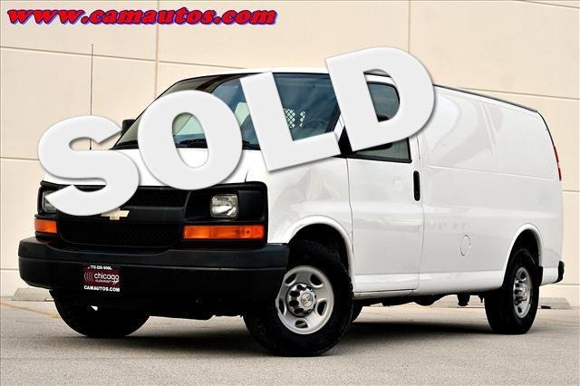

# Classifier failure analysis

These are failures of the deployed classifier (`checkpoints/model_quantized.onnx`) on the real Stanford Cars test set, from `scripts/evaluate_deployed_model.py` and `scripts/build_classifier_failures.py`. Detector and classical failures are in `docs/FAILURE_ANALYSIS.md`.

## How the errors break down

The model gave a wrong answer on 642 of 8,041 test images. How wrong:

| Kind of mistake | Images | Share of errors |
|---|---|---|
| Same manufacturer and model, different year | 41 | 6.4% |
| Same manufacturer, different model | 359 | 55.9% |
| Different manufacturer | 242 | 37.7% |

196 of the 642 errors still had at least 90% calibrated confidence, so a high confidence does not guarantee a right answer. The confident state in the app is right 95% of the time on this test set, not always.

## Six of the most confident wrong answers

These are picked from the most confident errors to show distinct causes. They are not a random sample, so use the table above for the overall picture. Causes were written after looking at each photo. Where we say a label "appears" wrong, we could not check it independently.

### 1. A Jeep Compass is called a Grand Cherokee

- **True label:** Jeep Compass SUV 2012
- **Model's answer:** Jeep Grand Cherokee SUV 2012 (100.0% confidence; correct class 0.00%)
- **Cause:** The photo shows a black SUV with Jeep's seven-slot grille, which to us looks like a Grand Cherokee, not a Compass. If that is right, the model is correct and the dataset label is wrong. We cannot check the label independently, so it counts as an error here, but it is probably label noise.
- **Image:** `images/test/07654.jpg`

### 2. Two vans that are the same vehicle with different badges

- **True label:** Chevrolet Express Cargo Van 2007
- **Model's answer:** GMC Savana Van 2012 (100.0% confidence; correct class 0.00%)
- **Cause:** The Chevrolet Express and the GMC Savana are the same van with different badges. This photo shows a GMC badge on the grille, so the model's answer matches what is visible and the label names the twin model. Cause: twin vehicles, so the label is ambiguous.
- **Image:** `images/test/06675.jpg`

### 3. An Audi TT and an Audi TT RS in a blurred photo

- **True label:** Audi TT Hatchback 2011
- **Model's answer:** Audi TT RS Coupe 2012 (100.0% confidence; correct class 0.00%)
- **Cause:** The TT and the TT RS differ mostly in trim details such as the grille, bumpers and wheels, and this photo is motion-blurred, which removes those details. The model chose the RS coupe, the closest class of the same model. Cause: a fine trim difference, made worse by blur. The label also names a different year.
- **Image:** `images/test/07095.jpg`

### 4. An Aston Martin V8 Vantage seen only from behind

- **True label:** Aston Martin V8 Vantage Coupe 2012
- **Model's answer:** Aston Martin Virage Coupe 2012 (100.0% confidence; correct class 0.00%)
- **Cause:** This is a studio view from the rear three-quarter, which hides the front grille and air intakes that separate the models. Both the V8 Vantage and the Virage are low, long-bonnet Aston Martin coupes. Cause: the viewpoint hides the features that tell the models apart.
- **Image:** `images/test/01821.jpg`

### 5. A Silverado 1500 and a Silverado 2500HD

- **True label:** Chevrolet Silverado 1500 Regular Cab 2012
- **Model's answer:** Chevrolet Silverado 2500HD Regular Cab 2012 (100.0% confidence; correct class 0.02%)
- **Cause:** Both are Silverado regular cab pickups with the same cab and body. They differ in payload class and small details, which are hard to see from the side. Cause: near-identical models that differ by capacity, not by shape.
- **Image:** `images/test/07627.jpg`

### 6. A large 'SOLD' sticker over the windscreen

- **True label:** Chevrolet Express Cargo Van 2007
- **Model's answer:** Chevrolet Express Van 2007 (100.0% confidence; correct class 0.00%)
- **Cause:** A big 'SOLD' overlay covers part of the windscreen, and the dataset has two near-identical Express classes (Cargo Van and Van, both 2007). The model answered with the other Express class, so manufacturer, model and year were right and only the variant differed. Cause: the overlay hides detail, and the two classes look alike.
- **Image:** `images/test/07699.jpg`

## What this means

- Most mistakes are between neighbours: the same manufacturer, or twin or near-identical models (Chevrolet Express and GMC Savana, Silverado 1500 and 2500HD, TT and TT RS). The app's Top-5 list and the confirm step let a person correct these.
- Some of the most confident errors look like dataset label noise rather than model mistakes, so the true accuracy may be a little higher than reported.
- Three causes recur: trims and years that differ only in small details, viewpoints that hide those details, and photos with overlays, blur or occlusion.

## Limits

- The six cases are curated for variety, and the causes are our reading of the photos. We did not run an experiment to isolate each cause.
- Labels were not re-checked against the manufacturers' records.
- Results are for the deployed INT8 model on annotated crops with an 8% margin, not the full detect-then-classify pipeline.
