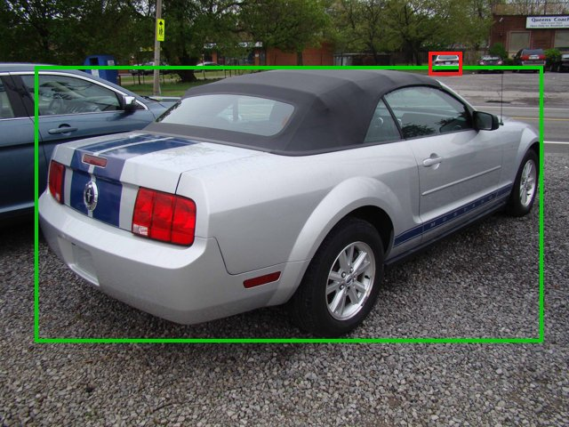
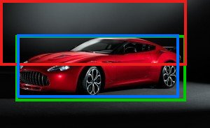
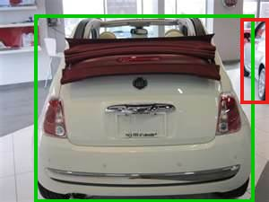
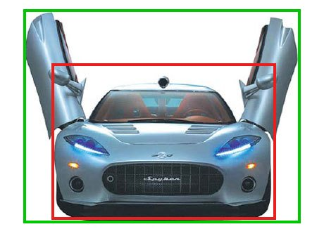
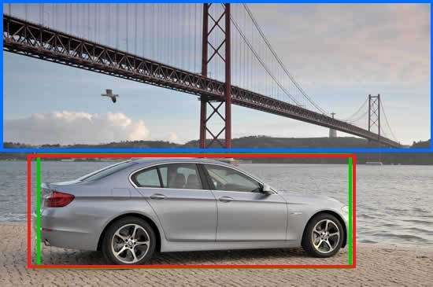

# Failure analysis

Generated by `scripts/build_failure_cases.py`. Green boxes are annotations, red are the app's detector crop, and blue are other methods' boxes.
Localisation cases come from a random sample of 500 test images, using the ResNet-50 detector.

## 1. A tiny background car outranks the main car

- **Image:** `images/test/02413.jpg`, Ford Mustang Convertible 2007
- **Measured:** Top-score box IoU 0.00, at score 1.00
- **Cause:** The detector scores small distant cars as highly as the main subject, so choosing the top score selected a background car. This hit 68 of 500 sampled test images, and the app would have identified the wrong car.
- **Improvement:** Fixed: the app now crops the largest box scoring at least 0.5, chosen on validation. This image rises to IoU 0.95, and IoU failures fall to 4 of 500.
- **Status:** Fixed

## 2. The fix itself fails on a weak, large box

- **Image:** `images/test/02111.jpg`, Aston Martin V8 Vantage Coupe 2012
- **Measured:** Chosen box IoU 0.28, score 0.56. Top-score box IoU 0.90
- **Cause:** A large low-confidence box covering dark studio background just passes the 0.5 score limit and beats the correct box. Preferring large boxes has this cost.
- **Improvement:** Possible improvement: test a higher score limit or score multiplied by area on validation. Score times area was close on validation, so it's the first candidate.
- **Status:** Open: known trade-off of the fix

## 3. A very close car is missed in favour of a partial one

- **Image:** `images/test/04814.jpg`, FIAT 500 Convertible 2012
- **Measured:** Chosen box IoU 0.03, score 1.00
- **Cause:** The main car fills the frame and shows its rear with a folded roof, a less common view, so no confident box covers it. The largest confident box is a sliver of another car at the edge.
- **Improvement:** Possible improvement: ignore boxes cut off by the image edge when a central vehicle exists, or fall back to the full frame when the chosen box is narrow.
- **Status:** Open

## 4. Raised doors fall outside the detector's box

- **Image:** `images/test/02234.jpg`, Spyker C8 Coupe 2009
- **Measured:** Chosen box IoU 0.59, score 1.00
- **Cause:** COCO training images rarely show scissor doors, so the box covers only the body, while the annotation includes the raised doors. The Ford GT example behaves the same way.
- **Improvement:** Effect on classification is unmeasured until detector-crop accuracy is run. The car's body stays in the crop, so the harm may be small. Retraining the detector on Stanford boxes could address it.
- **Status:** Open

## 5. The classical ROI locks onto the background

- **Image:** `images/test/05062.jpg`, BMW ActiveHybrid 5 Sedan 2012
- **Measured:** Contour ROI IoU 0.00. Detector IoU 0.95
- **Cause:** The largest-contour method assumes the car has the strongest outline. Here the bridge does, so the ROI misses the car completely. It has no idea what a car is.
- **Improvement:** This is why the app crops with the detector. The contour ROI stays as a visual explanation in the classical view, and isn't used for classification.
- **Status:** By design: detector used instead

## 6. Near-identical classes confuse the deep model

These counts are from `results/classifier_confused_pairs.csv`, across all 8,041 test images. Image-level examples need the saved logits and aren't included yet.

| Class A | Class B | Confusions |
|---|---|---|
| Dodge Caliber Wagon 2012 | Dodge Caliber Wagon 2007 | 20 |
| Audi V8 Sedan 1994 | Audi 100 Sedan 1994 | 20 |
| Audi TTS Coupe 2012 | Audi TT Hatchback 2011 | 18 |
| Chevrolet Express Van 2007 | GMC Savana Van 2012 | 17 |
| Chevrolet Silverado 2500HD Regular Cab 2012 | Chevrolet Silverado 1500 Regular Cab 2012 | 17 |

- **Cause:** these are the same or very closely related vehicles. Examples are model years with little visual change, performance trims of one body, and rebadged vans. Some differences aren't visible from every angle.
- **Improvement:** the app can show Top-5 and an ambiguous state rather than one firm answer. Training at a higher resolution or adding attention to parts may help, but neither has been tested.
- **Status:** Open. This is the main remaining limit of the classifier.
