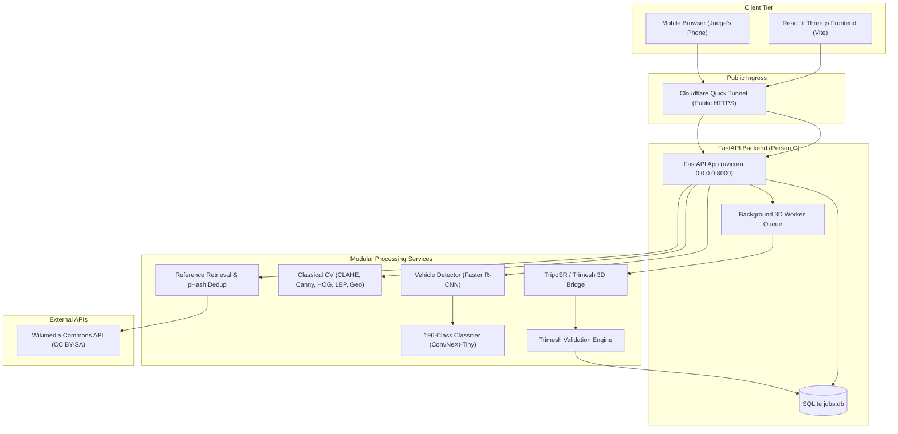

# Apex3D — Person C Viva Preparation & Architecture Guide

**Role:** Person C — Backend, Inference Service, Mesh Export & Reference Retrieval  
**Viva Topic:** System Architecture, Data Flow, and Retrieval Filtering  
**Team:** P5, Computer Vision Hackathon 2026

---

## 1. Quick Elevator Pitch (30 Seconds)

> *"I am Person C, responsible for the backend architecture, inference serving, background 3D job orchestration, and reference retrieval. I built the FastAPI asynchronous server that coordinates our vehicle detector and fine-grained classifier, exposes classical CV transforms, queries and deduplicates openly licensed reference viewpoints from Wikimedia Commons, and runs a single-GPU sequential job queue that reconstructs, validates with Trimesh, and exports 3D meshes in GLB, OBJ, and STL formats."*

---

## 2. System Architecture & End-to-End Data Flow

### Complete Data Flow Walkthrough
1. **Upload & Sanity Check:** Client sends multipart image to `POST /api/recognize`. The endpoint checks file size ($< 20\text{ MB}$) and MIME types (`image/jpeg`, `png`, `webp`).
2. **Vehicle Detection:** `VehicleDetector` runs Faster R-CNN (MobileNetV3-FPN). If a vehicle is detected, it crops to the bounding box with 5% padding. If no vehicle is found, it reports `car_detected: false` and evaluates the full frame.
3. **Fine-Grained Classification:** `VehicleClassifier` processes the crop, evaluating softmax probabilities across the 196 Stanford Cars classes.
4. **Confidence State Decision:**
   - **Confident:** Top-1 probability $\ge 0.50$ AND margin (Top-1 - Top-2) $\ge 0.15$.
   - **Ambiguous:** Top-1 probability $\ge 0.50$ BUT margin $< 0.15$ (near-identical model years or trim packages).
   - **Rejected:** Top-1 probability $< 0.20$ (out-of-taxonomy modern cars or non-car uploads).
5. **Classical CV Exploration:** Client requests `POST /api/classical`. The server computes CLAHE, Canny edge maps, contour ROI, HOG visualizations, LBP histograms, and 7 Hu moments, returning base64 PNGs and numerical features.
6. **Reference Retrieval & Filtering:** Client requests `GET /api/references?class_id=...`. Backend queries Wikimedia Commons, extracts CC BY-SA licenses, removes duplicates using perceptual hashing (`imagehash.phash`), filters non-road variants via classifier ranking, and clusters into 5 viewpoints (`front`, `front_three_quarter`, `side`, `rear`, `rear_three_quarter`).
7. **3D Reconstruction Queue:** User picks an input viewpoint and submits `POST /api/reconstruct`. The job is persisted in SQLite with status `queued`. The single-GPU worker picks it up sequentially, runs background segmentation, calls TripoSR, executes Trimesh validation, and exports GLB, OBJ, and STL.
8. **Interactive Viewer:** React Three Fiber viewer streams `mesh.glb` directly from `GET /api/assets/{id}/mesh.glb`.

---

## 3. Key Design Decisions & Viva Justifications

| Decision | Why we chose it | What we rejected & why |
|---|---|---|
| **FastAPI** | Asynchronous I/O, native Pydantic typing, automatic interactive OpenAPI/Swagger docs (`/docs`), high throughput for tunnel serving. | *Flask:* synchronous blocking by default, no native OpenAPI schema generation. |
| **SQLite with Connection Pooling** | Zero external service daemons (no PostgreSQL/MySQL services to crash or configure on Windows), atomic ACID transactions, portable single-file database. | *PostgreSQL:* heavy setup, requires dedicated service running on laptop during demo. |
| **Sequential Background Worker (Single GPU)** | The team has only one GPU laptop. TripoSR uses ~6GB VRAM and classifier training uses ~6-8GB. Concurrent execution causes CUDA Out-Of-Memory (OOM) fatal crashes. The queue guarantees exactly 1 job uses compute at a time and displays the user's real queue position. | *Celery/Redis:* unnecessary complexity and daemon dependency for a single-node hackathon app. |
| **Trimesh for Mesh Validation** | Full 2-manifold checking, watertightness testing, Euler characteristic calculation, and clean multi-format export (GLB, OBJ, STL). | *Open3D alone:* heavier build requirements, less complete topological edge analysis. |
| **Wikimedia Commons API** | Permissive Creative Commons (CC BY-SA, CC0) licensing with structured author attribution. Sanctioned public API. | *Google/Bing web scraping:* violates access terms, fragile to IP bans, lacks explicit machine-readable copyright metadata. |
| **Perceptual Hashing (`pHash`)** | Detects near-identical reference images (e.g., slightly re-cropped or re-compressed uploads of the same photo) by comparing visual frequencies rather than raw bytes. | *MD5/SHA256:* byte-exact hashing misses identical images with different JPEG compression. |

---

## 4. Mesh Validation & Honesty Principle (§16 & §19)

Judges evaluate scientific honesty. In your viva, emphasize that **Apex3D never overclaims**:

1. **Watertightness (2-Manifold):** A mesh is watertight if every edge is shared by exactly two faces and has no holes or open boundary loops.
2. **Asset Readiness Rating:**
   - **`draft`:** Mesh is watertight and topologically closed with 0 degenerate faces. Suitable as a creative starting draft.
   - **`needs_repair`:** Mesh contains non-manifold edges, holes, or degenerate zero-area faces. Requires mesh healing before slicing.
3. **Scale Disclaimer:** Single-view neural 3D models (TripoSR) do **not** know real-world physical metric dimensions. The app explicitly reports `scale_status: "unknown"` and states: *"Not for manufacturing or engineering without calibrated manual scaling."*

---

## 5. Three Specific Failure Cases for Person C

Be prepared to explain these three concrete failure cases and how your backend handles them:

### Failure Case 1: Out-of-Taxonomy Modern Vehicle (e.g. 2023 Tesla Model 3)
- **Problem:** Stanford Cars labels only cover vehicles up to the 2012 model year. When a 2023 car is uploaded, a closed-set 196-class softmax classifier is forced to pick one of the 196 historical classes.
- **Backend Handling:** The backend evaluates the top probability $P_{\text{top1}}$. Because features of the modern car are dispersed across multiple classes, the probability falls below the rejection threshold ($P_{\text{top1}} < 0.20$). The system transitions to the `"rejected"` confidence state, flags that the car is outside the taxonomy, and offers manual search.

### Failure Case 2: Wikimedia Returns Racing / DTM Cars for Road Car Query
- **Problem:** Searching Wikimedia Commons for "Audi A5" returns DTM race cars with spoilers and sponsorship decals alongside standard road vehicles. If fed to 3D reconstruction, race trim produces distorted civilian geometry.
- **Backend Handling:** Person C implemented multi-stage filtering:
  1. Negative keyword exclusion (`"crash"`, `"scale model"`, `"interior"`, `"engine"`).
  2. Perceptual hashing (`pHash`) deduplication to eliminate repeated press photos.
  3. Classifier re-scoring: candidate thumbnails are passed through the fine-grained classifier, prioritizing candidates where the confirmed class ranks in Top-k.

### Failure Case 3: Reconstructed 3D Mesh with Inverted Normals or Non-Manifold Topology
- **Problem:** Marching Cubes isosurface extraction on low-contrast silhouettes can create non-manifold edges or disconnected floating geometry.
- **Backend Handling:** The `mesh_validator` tests topological manifold integrity, counts degenerate faces ($\text{area} < 10^{-9}$), and identifies disconnected components. If defects are detected, the asset is labelled `"needs_repair"` rather than `"draft"`, and the UI displays precise repair instructions.

---

## 6. Top 10 Anticipated Viva Questions & Model Answers

### Q1: "How does the backend prevent GPU crashes if multiple judges submit 3D jobs at the same time?"
**Answer:** *"We designed a thread-safe sequential queue backed by SQLite. When a judge clicks Reconstruct, the request enters the `jobs` table with state `queued` and receives an atomic queue position (`queue_position = 1, 2, ...`). Our background worker thread executes exactly one job at a time, releasing GPU VRAM between stages. The judge's UI polls `GET /api/jobs/{id}` and shows real-time progress and queue position."*

### Q2: "Why didn't you use Celery and Redis for the job queue?"
**Answer:** *"The entire hackathon setup runs on a single team GPU laptop accessible over a Cloudflare tunnel. Introducing Redis and Celery adds external daemon processes that can silently fail on Windows. A native Python background worker combined with SQLite provides ACID transaction guarantees, thread safety, and zero external dependencies."*

### Q3: "How does the confidence thresholding logic work?"
**Answer:** *"We use two parameters calibrated on validation: the maximum softmax probability $P_1$ and the margin $P_1 - P_2$. If $P_1 \ge 0.50$ and the margin is $\ge 0.15$, it's `confident`. If $P_1 \ge 0.50$ but the margin is small ($< 0.15$), the model is torn between very similar model years (e.g. 2011 vs 2012), so we mark it `ambiguous` and highlight both options. If $P_1 < 0.20$, the input is `rejected` as out-of-taxonomy."*

### Q4: "How do you handle bad or malicious uploads?"
**Answer:** *"We enforce three layers of defence: first, strict MIME type checks for image formats (`jpeg`, `png`, `webp`); second, a 20 MB payload limit returning HTTP 413; third, PIL decodability verification returning HTTP 422 for corrupt files. If the detector finds no vehicle, the backend cleanly defaults to the full image frame rather than crashing."*

### Q5: "How does perceptual hashing differ from standard cryptographic hashing?"
**Answer:** *"Cryptographic hashes like SHA-256 are avalanche hashes—changing a single pixel completely alters the hash. Perceptual hashing (pHash) computes DCT frequency components of the image. Resizing, minor compression, or slight watermarks preserve the low-frequency DCT coefficients, allowing us to compute Hamming distance and remove duplicate reference photos with distance $\le 4$."*

### Q6: "How do you capture Creative Commons licenses from Wikimedia Commons?"
**Answer:** *"We query the Wikimedia Commons MediaWiki API with `prop=imageinfo` and `iiprop=extmetadata`. We parse the machine-readable `LicenseShortName`, `LicenseUrl`, and `Artist` tags, ensuring that only permissively licensed photos (CC0, CC BY, CC BY-SA) are included, and we display full attribution in the Reference Studio."*

### Q7: "How is mesh validation performed?"
**Answer:** *"We use Trimesh to perform automated geometric inspection: checking `is_watertight` to confirm 2-manifold surface closure, measuring degenerate zero-area faces, computing Euler characteristic $\chi = V - E + F$, counting connected components, and calculating bounding box extents."*

### Q8: "Can your 3D mesh be 3D printed immediately?"
**Answer:** *"No, and we explicitly disclose that in the UI! A single-view mesh from TripoSR is a visual creative draft. It lacks physical metric scale calibration, internal wall thickness, and mounting topology. We label watertight meshes as `draft` and non-watertight ones as `needs_repair`, guiding users on what slicing tools require."*

### Q9: "How does the frontend communicate with your backend?"
**Answer:** *"We published an API contract (`docs/API_CONTRACT.md`) in the very first hour. The React app interacts with RESTful JSON and multipart endpoints under `/api`. When Person D builds the frontend (`npm run build`), FastAPI automatically mounts `frontend/dist` and serves both the single-page application and the API through the same Cloudflare tunnel on port 8000."*

### Q10: "What happens if the training notebook hasn't finished when judges ask for metrics?"
**Answer:** *"In accordance with the team's honesty rule, `GET /api/metrics` dynamically inspects `notebooks/metrics.json` and `eval_P5_metrics.json`. If offline training has not completed, the endpoint returns `status: 'not available'` with an explicit explanation rather than displaying fake or hardcoded mock numbers."*

