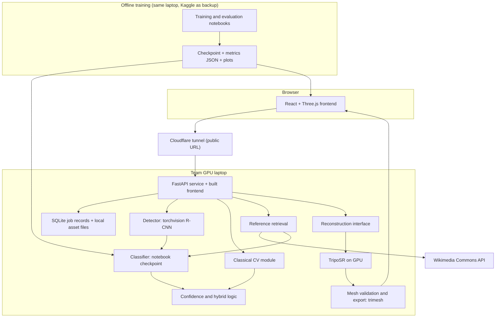

# Apex3D — Project Proposal

**Problem statement:** P5, Intelligent Fine-Grained Vehicle Recognition and Analysis System (Computer Vision Hackathon 2026)
**Repository:** https://github.com/sinchanaa23/Apex3D
**Status date:** 2026-11-06

> **Status legend** — every feature in this document carries one of these labels.
> `[DONE]` implemented and tested · `[PLANNED]` committed for this submission · `[EXPERIMENTAL]` attempted if time allows, labelled as such in the app · `[FUTURE]` not part of this submission.
>
> **Current state: nothing is implemented yet.** The repository is empty. No model has been trained, so this document contains no measured results. Numbers marked *target* or *estimate* are not measurements.

---

## 1. Title and tagline

**Apex3D** — *Recognise. Reconstruct. Create.*

## 2. Abstract

Apex3D identifies the make, model and year of a car in an uploaded photograph, then uses that identity to help create a 3D asset. A pretrained R-CNN localises the vehicle. A ConvNeXt classifier, fine-tuned on Stanford Cars in a reproducible Jupyter notebook, predicts one of 196 classes, and low-confidence results are handled explicitly. Classical computer vision (CLAHE, Canny, contours, HSV, HOG, LBP, geometric descriptors) is implemented, shown in the app, and compared against deep and hybrid approaches. The predicted identity drives a search for openly licensed reference images, which are checked by the classifier and grouped by viewpoint. The user then generates a mesh with the MIT-licensed TripoSR model, inspects it in an interactive viewer, and exports it after automated mesh validation.

## 3. Problem statement

P5 requires a hosted application that accepts a vehicle image, draws a bounding box, predicts make, model and year with a confidence score, shows intermediate image-processing results, and compares classical, deep and hybrid approaches.

| Mandatory item | Source in P5 |
|---|---|
| Preprocessing, edges and contours, colour and texture features, ROI extraction, geometric analysis | §3A |
| CNN or ViT fine-grained classifier across 196 classes, with transfer learning and fine-tuning | §3B |
| YOLO or R-CNN vehicle detection | §3B |
| Classical plus deep integration, detected-region classification, boxes with labels and confidence, low-confidence handling | §3C |
| Similar-class discrimination; illumination, viewpoint, occlusion and resolution robustness | §4 |
| Classical vs deep vs hybrid comparison | §4.4 |
| Ablation study | §4.5 |
| At least one optimisation technique (quantization, pruning or reduced precision) | §4.6 |
| Evaluation on unseen images; at least three explained failure cases | §4.7–4.8 |
| Metrics: Top-1, Top-5, IoU, mAP, model size, inference time, robustness, confidence and threshold analysis | §5 |
| Live hosted URL | Instruction sheet |
| GitHub repo with source, architecture diagram, design document, `eval_P5_<TeamID>.md`, ablation and failure analysis | Instruction sheet |

Number-plate recognition, tracking and traffic events are explicitly out of scope in P5.

**3D generation and reference retrieval are our additions.** P5 does not ask for them and they earn no direct rubric points, so they must never endanger the mandatory items.

### Open issues in the source documents

1. **Rubric weights contradict themselves.** The prose says Demo is 25 points and "each of the other five criteria" is 15, which implies six criteria. The table lists five: Evaluation Metrics 25, Implementation 20, UI/UX 15, Documentation 15, Demo 25. The Evaluation and Implementation score bands also stop at 15. *Working assumption: the table is correct. To confirm with organisers.*
2. **Design-document template is missing.** The rubric requires "every template section", but the PDF has no template. *To request from organisers.*
3. **No deadline in the PDF.** Lateness costs 5 points per 15 minutes.
4. **Dataset link.** The official Stanford page refused the connection when tested today, and torchvision documents the original download URL as broken. See §12.
5. **Meaning of "live hosted URL".** Apex3D plans to serve the public URL from a team laptop through a Cloudflare tunnel. The PDF doesn't say whether this qualifies. *To confirm with organisers.*

## 4. Background and motivation

Fine-grained recognition is difficult because classes differ in small details such as grilles, light signatures and trim lines, while pose, lighting and background vary far more. Stanford Cars is a standard benchmark for this problem. A recognition label is rarely the end goal, though. Designers, game developers and visualisation artists often want a usable asset of the vehicle, and open image-to-3D models now make a first draft achievable. Apex3D connects these two capabilities and is open about the gap between a draft and a production asset.

## 5. Existing approaches and limitations

| Approach | Strength | Limitation relevant here |
|---|---|---|
| Handcrafted features with a linear classifier | Interpretable, cheap | Generally weak on subtle fine-grained differences |
| CNN or ViT transfer learning | Strong accuracy on benchmarks | Closed-set: forced to choose one of 196 classes |
| Attention and part-based fine-grained models | Better at local details | More complex to train; little direct route to an asset |
| Single-image 3D (TripoSR, SF3D) | Fast | Unseen sides are inferred, not observed; not dimensionally accurate |
| Multi-view 3D (Hunyuan3D-2mv, TRELLIS multi-image) | Uses more evidence | Heavier hardware; expects views consistent with one object |

## 6. Research gap

We do not claim that nobody has combined these ideas. We investigate these specific gaps:

- **Closed-set recognition:** a 2023 car or a van still receives a confident-looking class, so rejection must be evaluated rather than assumed.
- **Generation confusion:** visually near-identical model years, measured using confusion pairs.
- **Same model is not the same car:** retrieved references differ in trim, wheels and bumpers, which undermines multi-view consistency.
- **Visual plausibility vs geometric accuracy:** a mesh can look right and still have the wrong proportions. Without ground-truth 3D data we report no accuracy metric.
- **Draft vs production-ready:** image-to-3D output often lacks the topology, UVs, watertightness and real-world scale needed for games or printing.

## 7. Proposed solution

A staged pipeline with a person in the loop. Each stage produces something the user can inspect and correct before the next stage runs.

**Upload → Detect → Classify → Confirm identity → Build reference pack → Reconstruct → Validate → View and export**

## 8. Objectives

1. `[PLANNED]` Train and evaluate a 196-class classifier in a reproducible notebook.
2. `[PLANNED]` Implement detection, classical CV and hybrid fusion, and compare them on one consistent split.
3. `[PLANNED]` Run an ablation study, robustness tests, threshold analysis and one optimisation technique.
4. `[PLANNED]` Deploy a public URL that works on phone and laptop, with recognition responding in about 10 seconds (*target*).
5. `[PLANNED]` Produce a real mesh with an open-source backend and display that actual file in a browser viewer.
6. `[PLANNED]` Report mesh validation honestly and never label an unvalidated mesh as print-ready.

## 9. Core features

| Feature | Status |
|---|---|
| R-CNN detection with bounding box and crop | `[PLANNED]` |
| Make, model and year prediction, confidence, Top-5 | `[PLANNED]` |
| Low-confidence and ambiguous handling, user correction | `[PLANNED]` |
| Intermediate classical CV visualisation | `[PLANNED]` |
| Classical vs deep vs hybrid comparison page, using saved real results | `[PLANNED]` |
| Wikimedia Commons reference retrieval with licence attribution | `[PLANNED]` |
| Duplicate removal, classifier-based filtering, viewpoint grouping | `[PLANNED]` |
| Manual reference upload | `[PLANNED]` |
| Single-image reconstruction with TripoSR | `[PLANNED]` |
| Three.js viewer loading the generated GLB | `[PLANNED]` |
| GLB, OBJ and STL export; mesh validation report | `[PLANNED]` |
| Optional Stanford Cars local reference fallback (local runs only, see §21) | `[PLANNED]` |
| FBX export through Blender | `[EXPERIMENTAL]` local only |
| True multi-view reconstruction (TRELLIS multi-image) | `[EXPERIMENTAL]` |
| Mesh repair and retopology for production use | `[FUTURE]` |

## 10. System architecture

The core logic lives in plain Python modules with no hosting dependency, so the same code can move to another server later. FastAPI serves both the API and the built frontend, so one tunnel exposes the whole app. Reconstruction sits behind one interface, so the backend can be swapped.

## 11. Data flow

1. The image is uploaded, validated (type, size, decodable) and normalised.
2. The R-CNN returns vehicle boxes. If there is none, the user is told clearly and may proceed with the full frame, marked as such.
3. The crop goes to the classifier, which returns Top-5 probabilities. The confidence and Top-1/Top-2 margin decide between *confident*, *ambiguous* and *rejected*.
4. Classical CV outputs are computed for display and hybrid features.
5. The user confirms or corrects the identity.
6. Retrieval builds the query, fetches candidates and licence metadata, removes duplicates, filters using the classifier, and groups by viewpoint.
7. The user approves the reference pack or uploads their own images, and picks the single input view for reconstruction.
8. The background is removed, TripoSR generates the mesh, and it is validated and exported.
9. The viewer loads the generated GLB, and downloads are offered.

Uploads and generated files are stored on the laptop only for as long as the job needs them, then deleted by a cleanup step. SQLite stores job status, not image content.

## 12. Dataset

**Stanford Cars** (Krause et al., 2013): 16,185 images, 196 classes, 8,144 train and 8,041 test, with bounding boxes. Labels are in the form *Make Model Type Year*.

- **Year is a label attribute, not a full generation model.** Apex3D reports the year as labelled and does not infer generations beyond it.
- **The taxonomy is dated.** It stops at 2012 model years, so newer cars are out of taxonomy and handled through rejection.
- **Acquisition:** the torchvision download is documented as broken. Planned source: the Kaggle mirror `jessicali9530/stanford-cars-dataset`. This is the same dataset, not a substitute.
- **Test labels:** the devkit's test annotations lack labels. torchvision expects `cars_test_annos_withlabels.mat`, which comes from a third party. The notebook will inspect the actual files and sanity-check them before they are trusted. **Not yet verified.**
- **Split:** stratified 85/15 train/validation from the 8,144 images. All tuning uses validation. The test set is used only for final reporting.
- **Licence:** the official terms page could not be reached today. The dataset is generally described as for non-commercial research. **To be confirmed in `docs/REFERENCES.md`.** Apex3D is therefore presented as a research demonstration.

No other dataset is used for training.

## 13. ML/CV methodology

**Detection.** Pretrained COCO `torchvision` R-CNN, keeping car, truck and bus classes. The ResNet-50 and MobileNetV3 FPN variants will be compared for IoU and CPU latency. No detector training is planned. Ultralytics YOLO is avoided because of its AGPL-3.0 terms, which also extend to self-trained models.

**Classification.** Pretrained `timm` ConvNeXt-Tiny, with an EfficientNetV2-S and a ResNet-50 baseline where time allows. Input resolution will be chosen from validation results (224 vs 384). Weight licences are checked before use.

**Training.** A staged approach: train the head, then unfreeze the backbone with layer-wise learning-rate decay. AdamW, cosine schedule, label smoothing, mixed precision, RandAugment and random erasing (which also helps with occlusion), and early stopping on validation accuracy.

**Notebook content.** `notebooks/01_classifier_training.ipynb` covers all 19 items in the brief, from dataset loading to model export. The app loads the checkpoint this notebook produces. Saved outputs stay in the notebook.

**Optimisation.** ONNX Runtime INT8 quantization, with half-precision as the fallback. Size, CPU latency and accuracy loss are reported before and after.

**Confidence.** Thresholds on maximum probability and Top-1/Top-2 margin are chosen on validation, with temperature scaling if calibration is poor. Coverage-versus-accuracy curves are reported. Out-of-taxonomy behaviour is checked with a small labelled set of non-Stanford vehicles (labelled as a small qualitative sample).

## 14. Classical CV methodology

**Pipeline:** `[PLANNED]` normalisation → CLAHE (LAB luminance) → Canny → contours and largest-contour ROI → HSV histogram → HOG and LBP → geometric descriptors (aspect ratio, extent, solidity, Hu moments).

**Classical classifier:** PCA followed by a linear SVM on these features, as the classical baseline.

**Hybrid:** two candidate strategies, both validated rather than assumed useful:

1. **Feature fusion:** CNN embeddings concatenated with PCA-reduced classical features, then a linear classifier.
2. **Adaptive preprocessing:** apply CLAHE only when image statistics indicate low light, and test whether this improves robustness.

If fusion does not improve on the deep model, we report that outcome and keep the better model in the app.

## 15. Reference retrieval methodology

**Source:** the Wikimedia Commons API, tested today. It returned image URLs with per-file licence metadata (CC BY-SA variants). No search-engine scraping or bypassing of access restrictions. Openverse is a possible second source.

**The test also showed why filtering is required:** a search for "Audi A4" returned DTM race cars alongside road cars.

**Steps:**
1. Build a query from make, model and year.
2. Fetch candidates and licence metadata, keeping only permissively licensed files.
3. Remove duplicates with perceptual hashing.
4. Detect the vehicle, then run the trained classifier. Candidates are scored by whether the confirmed class appears in the Top-k.
5. Classify viewpoint (front, front three-quarter, side, rear, rear three-quarter) by OpenCLIP zero-shot prompts. Accuracy is checked on a small hand-labelled sample.
6. Rank and display with source, author and licence.

**Honesty rule shown in the UI:** references are images of the *same model*, not the same physical car. Trim, generation and bodywork may differ. Anything not positively matched is labelled *approximate reference*.

**Fallback:** manual upload always works. A Stanford Cars fallback is available for local runs only.

## 16. 3D reconstruction methodology

| Candidate | Licence (checked today) | Hardware | Input | Decision |
|---|---|---|---|---|
| **TripoSR** | MIT, code and weights | ~6 GB VRAM by default | **One image.** Several paths just run separately | **Primary** |
| **TRELLIS** | MIT for models and most code; some submodules differ | 16 GB VRAM; Linux; Windows not fully tested | Multi-image, tuning-free and not a specially trained model | **Experimental** |
| **TRELLIS.2** | MIT; NVIDIA dependencies have their own licences | 24 GB VRAM; Linux only | Single image documented | Rejected |
| **Hunyuan3D-2 / 2mv** | Tencent Community Licence, not open source. Excludes EU, UK, South Korea. Restricts using outputs to improve other models | ~6 GB shape, 16 GB with texture; Windows supported | Genuine multi-view (2mv) | Rejected as default: conflicts with open-source constraint and geographically restricted |
| **Stable Fast 3D** | Stability Community Licence, free under US$1M revenue; gated weights | ~6 GB; CPU supported; Windows experimental | One image | Rejected: not open source; TripoSR covers this role |

**How the reference pack is used.** TripoSR takes one image, so references are **not** fused into its geometry. They help the user choose the best input view, and they sit beside the mesh for visual comparison. The app states that the result is a single-view reconstruction whose unseen sides are inferred.

**Validation with `trimesh`:** watertightness, non-manifold edges, degenerate faces, connected components, polygon count, texture or vertex-colour presence and generation time. Scale is **unknown** because the source is a single image, so the app never claims real-world dimensions or "print-ready" status.

**Asset guidance displayed:** games need retopology, UVs and LODs. Printing needs repair, scaling and wall-thickness checks.

**Benchmark caveat.** TripoSR's published speed is under 0.5 s on an A100, and the team laptop's GPU will be slower. Its model and VRAM are not yet known: TripoSR's defaults need about 6 GB, so a smaller GPU may need lower settings or a CPU run. Building `torchmcubes` on Windows may also need C++ build tools. This is the first thing we test. Windows support for TRELLIS is not fully tested, so that experiment may not be possible on this laptop.

## 17. Technology stack and justification

| Layer | Choice | Why |
|---|---|---|
| Training | Jupyter notebook on the team GPU laptop, PyTorch, timm | Local GPU with no session limits. Kaggle's free GPU is the backup if VRAM or time falls short |
| Detection | torchvision R-CNN | Meets "YOLO or R-CNN", permissive code licence, no training required |
| Classical CV | OpenCV, scikit-image, scikit-learn | Standard and easy to explain in the viva |
| Serving | FastAPI, Uvicorn, SQLite, local files | As briefed. Simple to run from one command on Windows |
| Public access | Cloudflare quick tunnel from the GPU laptop | No team account qualifies for free ZeroGPU hosting, and HF Docker Spaces need a paid plan |
| Stable link | Small static page, such as GitHub Pages, linking to the current tunnel URL | Quick tunnel URLs change on restart. Subject to organiser approval |
| Inference optimisation | ONNX Runtime | Meets P5's optimisation requirement and lets recognition keep running while the GPU is busy with 3D |
| Reconstruction | TripoSR, trimesh | MIT; fits a mid-range GPU if it has about 6 GB VRAM (to be verified) |
| Frontend | React, TypeScript, Vite, Tailwind, React Three Fiber, Framer Motion | As briefed. Served by FastAPI |
| Backup | Recognition on a second team laptop, plus a recorded demo | Covers failure of the GPU laptop during judging |

**Deliberate choices, and why:**
- **Python 3.12, not the latest release.** Machine-learning packages are usually slower to support the newest Python.
- **Docker not used.** The rubric accepts "one command or a Dockerfile". We aim for one command.
- **Four-person split.** Roles, schedule and handovers are in the team workplan.

## 18. Evaluation methodology

Results go in `eval_P5_<TeamID>.md`, in P5's metric order, with the USNs as the first line.

| P5 metric | Method |
|---|---|
| Top-1, Top-5 | Unseen test set; ground-truth crop and detector crop reported separately |
| IoU | Detector top vehicle box vs annotation |
| mAP | COCO-style AP on the single "vehicle" class. Caveat: images carry one annotated box, so other visible cars can count as false positives |
| Model size and inference time | Measured on the GPU laptop's GPU and CPU, before and after optimisation |
| Robustness | Brightness, low light, blur, noise, low resolution and synthetic occlusion at several severities |
| Confidence | Threshold, margin, coverage-accuracy and rejection curves |

**Also required or planned:** per-class precision/recall/F1, confusion matrix and most-confused pairs; classical vs deep vs hybrid on the same split; at least three explained failure cases.

**Ablation study:** remove one component at a time (detector crop, CLAHE, classical features, augmentation, fine-tuning beyond the head, optimisation). Inference-time ablations run on the full test set. Retraining ablations may use fewer epochs, and this will be disclosed.

**3D:** generation time, file size, polygon count, texture availability, integrity checks and human visual review, with no accuracy metrics claimed in the absence of ground truth.

**Integrity rule.** The app reads metrics only from JSON files produced by the notebooks. If a file is absent, the page says so.

## 19. Innovation and USP

Recognition becomes a route to an asset. The specific contributions are:
- The trained classifier is reused to **verify retrieved references**, turning a recognition model into a filter.
- Uncertainty is shown and acted upon, and the user may correct the identity.
- The app reports **asset readiness** by validation rather than implying a mesh is finished.
- The limits on single-view geometry and same-model references are stated in the product itself.

## 20. Target users and applications

3D artists and game developers who need a starting mesh; automotive enthusiasts and educators; computer-vision students studying fine-grained recognition. Outputs are drafts that require further work for production.

## 21. Limitations and ethical considerations

- **Closed set:** limited to 196 classes up to 2012 models. Other cars may be misidentified, and rejection will not catch them all.
- **Single-view geometry:** unseen sides are invented and proportions are not measured. Not for engineering, safety or insurance use.
- **Dataset terms:** expected to limit use to research. The project should not be sold as-is without review.
- **Bias:** the dataset skews towards US-market cars, so accuracy on other regions' vehicles is likely lower. This is a hypothesis we cannot measure with the labels available.
- **Intellectual property:** car designs and trademarks may be protected. A generated mesh does not grant rights to reproduce or sell a design.
- **Image rights:** references keep their attribution and CC BY-SA terms may apply to derivatives. Bundling Stanford images into a public host is avoided, so that fallback is local only.
- **Privacy:** uploads may contain people or number plates, and they pass through a tunnel to a team member's laptop. They are deleted after processing, and Apex3D does no plate recognition. Tunnelled exposure also means the service should offer only its own endpoints, with upload limits.
- **Hosting limits:** the public URL works only while one laptop is on, awake and connected. It's a demonstration setup, not production hosting: there's no redundancy, one GPU limits how many jobs can run, and the URL changes if the tunnel restarts.

## 22. Expected outcomes

A deployed application, trained checkpoint, notebooks with genuine outputs, comparison and ablation results, failure analysis, and working mesh generation with validated exports.

Fine-grained classifiers with transfer learning often exceed 85% Top-1 on this dataset, so our *target* is at or above that level. **This is a goal, not a result.**

## 23. Development timeline

Times are *estimates* counted from the start of work. The deadline is to be confirmed.

| Hours | Milestone | Owner | Priority |
|---|---|---|---|
| 0–1 | TripoSR test on the GPU laptop; dataset verified; repo and API contract pushed | A, B, C | P0 |
| 1–3.5 | Classifier training on the GPU laptop | A | P0 |
| 1–3.5 | Classical CV, detector metrics, recognition API | B, C | P0 |
| 0–3.5 | Frontend: shell, upload, identity, classical view | D | P0 |
| 3.5–6 | Export, quantization, hybrid, ablation, robustness | A, B | P0 |
| 3.5–5.5 | 3D jobs, export, validation, viewer, research lab | C, D | P0/P1 |
| 5–6.5 | Reference retrieval and Reference Studio | C, D | P1 |
| 6.5–7.5 | Tunnel hosting, phone and laptop testing, unseen-input testing | All | P0 |
| 7.5–8.5 | Documentation, eval file, failure cases, demo rehearsal | All | P0 |

Training and 3D work share one GPU, so Person A schedules GPU time.

**If time runs short, cut in this order:** FBX, TRELLIS experiment, viewpoint classification (grouping becomes manual), Reference Studio polish. Retrieval falls back to manual upload. The P5 mandatory items are never cut.

## 24. References

1. J. Krause, M. Stark, J. Deng, L. Fei-Fei. *3D Object Representations for Fine-Grained Categorization.* 3dRR, ICCV Workshops, 2013.
2. Z. Liu et al. *A ConvNet for the 2020s.* CVPR, 2022.
3. S. Ren, K. He, R. Girshick, J. Sun. *Faster R-CNN.* NeurIPS, 2015.
4. D. Tochilkin et al. *TripoSR: Fast 3D Object Reconstruction from a Single Image.* arXiv:2403.02151, 2024.
5. J. Xiang et al. *Structured 3D Latents for Scalable and Versatile 3D Generation (TRELLIS).* arXiv:2412.01506, 2024.
6. Tencent Hunyuan3D Team. *Hunyuan3D 2.0.* arXiv:2501.12202, 2025.
7. M. Boss et al. *SF3D: Stable Fast 3D Mesh Reconstruction.* arXiv:2408.00653, 2024.
8. N. Dalal, B. Triggs. *Histograms of Oriented Gradients for Human Detection.* CVPR, 2005.
9. T. Ojala, M. Pietikäinen, T. Mäenpää. *Multiresolution Gray-Scale and Rotation Invariant Texture Classification with Local Binary Patterns.* TPAMI, 2002.
10. K. Zuiderveld. *Contrast Limited Adaptive Histogram Equalization.* Graphics Gems IV, 1994.
11. A. Radford et al. *Learning Transferable Visual Models From Natural Language Supervision (CLIP).* ICML, 2021.
12. C. Guo et al. *On Calibration of Modern Neural Networks.* ICML, 2017.
