1RUA24CSE0461,1RUA24CSE0467,1RUA24CSE0445,1RUA24CSE0453

# Evaluation results: P5, team NoharaFam (T25)

**Team members:** Sinchana R Kambar (1RUA24CSE0461); Sohini Dutta (1RUA24CSE0467); Shreyas Muniraju Kolar (1RUA24CSE0445); Shubanck Prasoon Guptha (1RUA24CSE0453)

**Repository:** https://github.com/sinchanaa23/Apex3D

**Live demo:** https://apex3d-xvuc.onrender.com (sign up on first use; the first visit after a sleep takes about a minute)

Generated by `scripts/build_eval_report.py` from `results/`.

## 1. Classification performance (Top-1 and Top-5)

| Approach | Top-1 | Top-5 | Macro F1 | Test images |
|---|---|---|---|---|
| Classical (HOG, LBP, HSV, geometry + linear SVM) | 17.32% | 36.81% | 15.85% | 8041 |
| Deep (convnext_tiny.fb_in22k_ft_in1k) | 92.20% | 98.42% | 92.08% | 8041 |
| Deep, deployed (onnx_int8_static_matmul) | 92.18% | 98.51% | - | 8041 |
| Hybrid (deep_plus_geometry, chosen on validation) | 92.09% | 97.60% | 91.95% | 8041 |

All use annotated-box crops with an 8% margin on the unseen test split, with the same train and validation images. Chance is 0.51% Top-1 and 2.55% Top-5.

Deep make-level Top-1 is 97.15%. Of the deep model's errors, 63.48% are within the same make and 6.22% differ only by year.

Deep features alone with the same linear head: 92.18% Top-1. Change from adding classical features: -0.09 percentage points.

### The full pipeline: classifying detector crops

The rows above use annotated boxes, which a real photo doesn't have. Here the deployed classifier receives the crop the app would use, on the same images each time.

| Detector | Annotated box Top-1 | Detector crop Top-1 (95% margin) | Detector crop Top-5 | Top-1 with the old top-score rule | Test images |
|---|---|---|---|---|---|
| MobileNetV3 (used by the app) | 91.80% | 92.40% ± 2.3 | 99.20% | 80.60% | random sample of 500 |
| ResNet-50 | 91.80% | 91.80% ± 2.4 | 98.80% | 79.60% | random sample of 500 |

An image with no box scoring at least 0.5 is classified on its full frame, as in the app. On this sample, detector crops did not measurably lower accuracy compared with annotated boxes. Choosing the wrong detected car did.

### Backbone comparison

Trained with the same split, crops, augmentation and schedule. Validation chose the model; test is shown for reporting.

| Backbone | Parameters | Validation Top-1 | Test Top-1 | Test Top-5 | Test macro F1 | CPU time per image |
|---|---|---|---|---|---|---|
| convnext_tiny.fb_in22k_ft_in1k | 28.0 M | 92.23% | 92.20% | 98.42% | 92.08% | 56 ms |
| resnet50.a1_in1k | 23.9 M | 83.55% | 81.58% | 95.70% | 81.49% | 54 ms |
| tf_efficientnetv2_s.in21k_ft_in1k | 20.4 M | 86.50% | 87.13% | 96.97% | 87.01% | 64 ms |

### Why two Top-1 figures appear for the deployed model

Person A's notebook scored the deployed model at 92.18%, and the app's own preprocessing scores 92.02%, 13 images apart. Rerunning the same model file independently reproduced the 642 errors behind the 92.02% figure, image for image. Resize method and JPEG caching change roughly 100 individual predictions but move Top-1 by under 0.2 points, and none of the variants here reproduces 92.18%. Person A's images came from a different mirror of the dataset, which may account for the rest, but this wasn't verified. Treat the deployed model's annotated-box Top-1 as about 92.0-92.2%. The app wasn't changed, because a gain of a few images isn't significant, and the deployed results in this report describe its current preprocessing.

| Preprocessing | Test Top-1 | Test Top-5 | Wrong images |
|---|---|---|---|
| Bilinear resize, as the app does | 92.02% | 98.40% | 642 |
| Bicubic resize, as in training | 92.10% | 98.50% | 635 |
| Bicubic, through a cached JPEG crop like the training notebook | 92.03% | 98.51% | 641 |
| Published by notebook 01b, on Person A's data copy | 92.18% | 98.51% | 629 |

## 2. Object localisation (IoU)

| Method | Mean IoU | Median IoU | IoU ≥ 0.5 | IoU ≥ 0.75 | Images |
|---|---|---|---|---|---|
| Faster R-CNN ResNet-50 FPN v2 | 0.931 | 0.949 | 99.20% | 98.20% | random sample of 500 test images |
| Faster R-CNN MobileNetV3 FPN | 0.916 | 0.934 | 98.60% | 97.80% | random sample of 500 test images |
| Classical contour ROI | 0.642 | 0.647 | 77.20% | 30.80% | random sample of 500 test images |

Returning the whole image with no detection at all gives a mean IoU of 0.564, so that's the bar a useful method has to beat. The contour ROI covered at least 90% of the frame on 34.20% of images.

### Choosing which detected vehicle to crop

Photos often contain several cars, and tiny background cars can score as high as the main subject. The rule was chosen on validation, then reported on test.

| Run | Selection rule | Mean IoU | IoU ≥ 0.5 | Images |
|---|---|---|---|---|
| Validation, MobileNetV3 | top_score | 0.781 | 84.00% | 400 |
| Validation, MobileNetV3 | largest_confident (used) | 0.915 | 99.00% | 400 |
| Validation, MobileNetV3 | score_times_area | 0.915 | 99.00% | 400 |
| Test, MobileNetV3 | top_score | 0.787 | 84.40% | 500 |
| Test, MobileNetV3 | largest_confident (used) | 0.916 | 98.60% | 500 |
| Test, MobileNetV3 | score_times_area | 0.916 | 98.80% | 500 |
| Test, ResNet-50 | top_score | 0.811 | 86.40% | 500 |
| Test, ResNet-50 | largest_confident (used) | 0.931 | 99.20% | 500 |
| Test, ResNet-50 | score_times_area | 0.934 | 99.80% | 500 |

## 3. Object detection (mAP)

| Detector | mAP@[.5:.95] | AP@.5 | AP@.75 | Images |
|---|---|---|---|---|
| Faster R-CNN ResNet-50 FPN v2 | 0.686 | 0.772 | 0.760 | random sample of 500 test images |
| Faster R-CNN MobileNetV3 FPN | 0.644 | 0.742 | 0.736 | random sample of 500 test images |

Caveat: Stanford Cars annotates one car per image, so correct detections of other cars count as false positives and these values understate real precision. The vehicle class combines COCO car, bus and truck, and the detectors were not retrained.

## 4. Model efficiency (size and inference time)

| Model | Size | Time per image | Test Top-1 | Hardware |
|---|---|---|---|---|
| pytorch_fp32 | 112.0 MB | 49.2 ms | 92.20% | Intel i5-12500H, batch 1 |
| onnx_fp32 | 112.0 MB | 34.3 ms | 92.20% | Intel i5-12500H, batch 1 |
| onnx_fp16 | 56.0 MB | 38.6 ms | 92.19% | Intel i5-12500H, batch 1 |
| onnx_int8_dynamic | 28.4 MB | 151.3 ms | 91.98% | Intel i5-12500H, batch 1 |
| onnx_int8_static_all | 28.7 MB | 21.6 ms | 86.11% | Intel i5-12500H, batch 1 |
| onnx_int8_static_matmul (deployed) | 34.6 MB | 19.4 ms | 92.18% | Intel i5-12500H, batch 1 |
| Hybrid (deep_plus_geometry): deployed deep model + geometry features + linear head | 35.8 MB | 22.6 ms | 92.09% | see note below |
| Classical model, including feature extraction | 2.5 MB | 15 ms | 17.32% | Intel i5-1135G7 |
| ResNet-50 detector | - | 5909 ms (median) | - | cpu, Intel i5-1135G7 |
| MobileNetV3 detector | - | 769 ms (median) | - | cpu, Intel i5-1135G7 |

Optimisation: static INT8 quantization of the MatMul layers. Timings come from different laptops, so don't compare times between the two CPUs directly.

Hybrid cost: the deep model's 34.6 MB and 19.4 ms are Person A's figures. Computing the geometry features (2.1 ms) and applying the linear head (1.1 ms, 1.2 MB) were timed here on 200 test crops, so the hybrid total mixes two machines. The extra steps are small next to the deep model.

## 5. Robustness (performance under varying conditions)

Evaluated on 1000 randomly sampled test images. Clean deep Top-1: 91.80%.

| Condition | Level | Deep Top-1 | Classical Top-1 | Deep + adaptive CLAHE |
|---|---|---|---|---|
| brightness | 1.5 | 90.70% | 11.10% | - |
| brightness | 2.0 | 90.10% | 8.60% | - |
| brightness | 2.5 | 87.60% | 7.10% | - |
| low_light | 0.6 | 89.40% | 11.60% | 88.90% |
| low_light | 0.35 | 87.50% | 8.20% | 86.20% |
| low_light | 0.15 | 79.00% | 4.10% | 76.80% |
| blur | 1.0 | 90.70% | 14.60% | - |
| blur | 2.5 | 79.70% | 9.20% | - |
| blur | 5.0 | 52.70% | 5.90% | - |
| noise | 15.0 | 91.30% | 13.00% | - |
| noise | 35.0 | 88.50% | 9.50% | - |
| noise | 60.0 | 82.60% | 6.20% | - |
| low_resolution | 128 | 85.10% | 10.70% | - |
| low_resolution | 64 | 51.50% | 6.20% | - |
| low_resolution | 32 | 9.00% | 2.20% | - |
| occlusion | 0.1 | 88.00% | 7.90% | - |
| occlusion | 0.25 | 79.30% | 2.70% | - |
| occlusion | 0.4 | 60.70% | 0.90% | - |

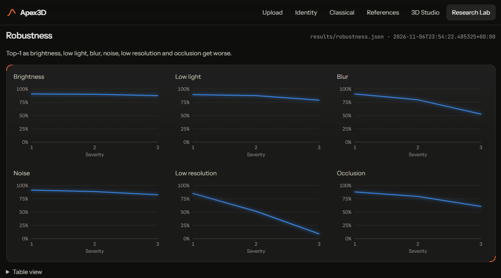

*Research Lab, robustness. Top-1 of the deployed model at three severities of each condition. Brightness, low light and noise cost a few points; heavy blur, low resolution and large occlusion cost the most.*

## 6. Confidence (prediction confidence and threshold analysis)

Temperature scaling (T = 0.617) was fitted on validation, reducing validation calibration error from 0.208 to 0.034. Test calibration error is 0.024. Thresholds were chosen on validation: confident at probability ≥ 0.52 and margin ≥ 0.34, rejected below 0.52.

| App state | Share of test images | Accuracy |
|---|---|---|
| confident | 93.52% | 95.04% |
| ambiguous | 1.27% | 59.80% |
| rejected | 5.21% | 49.16% |

### Photos outside the 196 classes

The classifier always names one of its 196 classes, so only the confidence rule protects against inputs it was never taught. Measured on the Caltech-101 test split: Caltech-101 test split, Hugging Face Multimodal-Fatima/Caltech101_not_background_test.

| Photos | Images | Rejected | Ambiguous | Confident |
|---|---|---|---|---|
| Other vehicles (airplanes, motorbikes, helicopters, boats) | 412 | 91.50% | 0.00% | 8.50% |
| Other things (animals, objects, scenes) | 600 | 98.33% | 0.00% | 1.67% |
| Stanford Cars photos, uncropped (for comparison) | 1200 | 12.33% | 1.33% | 86.33% |

Separating in-class from outside photos by top probability alone gives an AUROC of 0.977.

Limits: Whole photos with no detector crop. The app would crop to a detected car first. Caltech-101 photos are older and smaller than Stanford Cars. Caltech-101 has no newer car models, which is the likeliest real case, so this measures non-car inputs only. In-class images are scored uncropped here so both sides are treated alike.

### Coverage against accuracy (test)

| Confidence threshold | Images accepted | Accuracy when accepted |
|---|---|---|
| 0.0 | 100.00% | 92.02% |
| 0.18 | 99.70% | 92.22% |
| 0.36 | 97.84% | 93.28% |
| 0.54 | 94.78% | 94.63% |
| 0.72 | 90.65% | 95.91% |
| 0.9 | 83.02% | 97.06% |

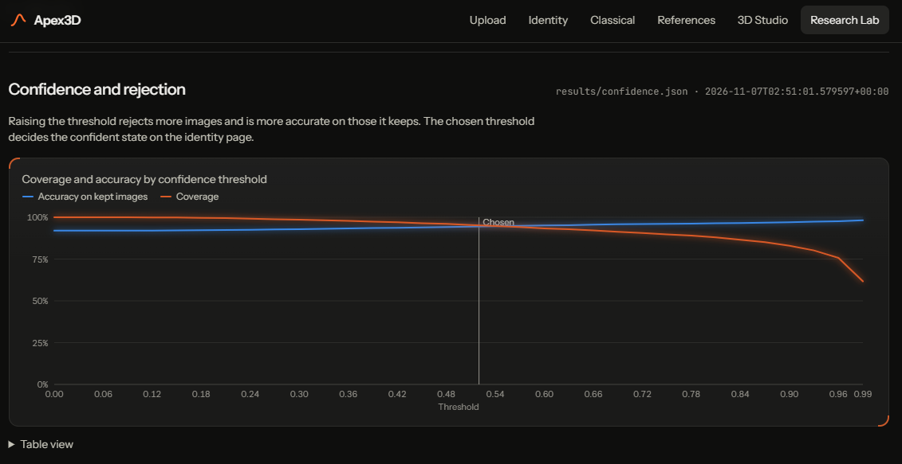

*Research Lab, confidence and rejection. Raising the confidence threshold lowers coverage (orange) and raises accuracy on the images kept (blue). The vertical line marks the threshold the app uses (0.52).*

## Comparison: classical, deep and hybrid

See section 1.

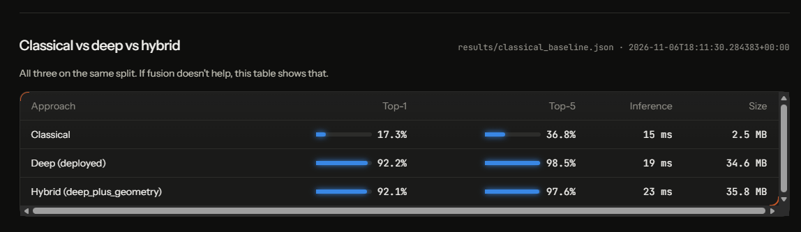

*Research Lab, classical against deep against hybrid, on the same split, with Top-1, Top-5, inference time and size. Adding classical features to the deep model gave no gain.*

### Classical feature families (validation)

| Features | Dimensions | Top-1 | Top-5 |
|---|---|---|---|
| hsv | 32 | 3.11% | 10.39% |
| lbp | 160 | 4.09% | 13.83% |
| hog | 1764 | 14.40% | 31.51% |
| geometry | 12 | 1.47% | 5.32% |
| all | 1968 | 16.78% | 33.72% |

Adaptive CLAHE changed classical validation Top-1 by -0.33 percentage points, on 1,222 validation images. A change this size may be noise.

## Ablation study

| Component changed | Split | Result | Change (points) |
|---|---|---|---|
| Classical: hsv features only | Validation | 3.11% | -13.67 |
| Classical: lbp features only | Validation | 4.09% | -12.68 |
| Classical: hog features only | Validation | 14.40% | -2.37 |
| Classical: geometry features only | Validation | 1.47% | -15.30 |
| Detector: top score instead of largest confident (500 images, mean IoU) | Test | 0.811 | -0.120 IoU |
| Full pipeline: top-score rule instead of largest confident (500 images) | Test | 80.60% | -11.80 |
| Full pipeline: annotated box instead of detector crop (500 images) | Test | 91.80% | -0.60 |
| Backbone: resnet50.a1_in1k instead of ConvNeXt-Tiny | Test | 81.58% | -10.62 |
| Backbone: tf_efficientnetv2_s.in21k_ft_in1k instead of ConvNeXt-Tiny | Test | 87.13% | -5.07 |
| Deep: onnx_int8_dynamic instead of ONNX FP32 | Test | 91.98% | -0.22 |
| Deep: onnx_int8_static_all instead of ONNX FP32 | Test | 86.11% | -6.09 |
| Deep: onnx_int8_static_matmul instead of ONNX FP32 | Test | 92.18% | -0.02 |
| Deep: onnx_fp16 instead of ONNX FP32 | Test | 92.19% | -0.01 |
| Deep: no crop, full image | Test | 86.15% | -5.87 |
| Hybrid: deep_plus_all_classical | Validation | 92.06% | -0.16 |
| Hybrid: deep_plus_hsv | Validation | 91.98% | -0.25 |
| Hybrid: deep_plus_lbp | Validation | 92.14% | -0.08 |
| Hybrid: deep_plus_hog | Validation | 92.06% | -0.16 |
| Hybrid: deep_plus_geometry | Validation | 92.23% | +0.00 |

Classical rows compare against all classical features, optimisation rows against ONNX FP32, no-crop against the annotated box, full-pipeline rows against the app's detector crop, backbone rows against ConvNeXt-Tiny, and hybrid rows against deep features alone.

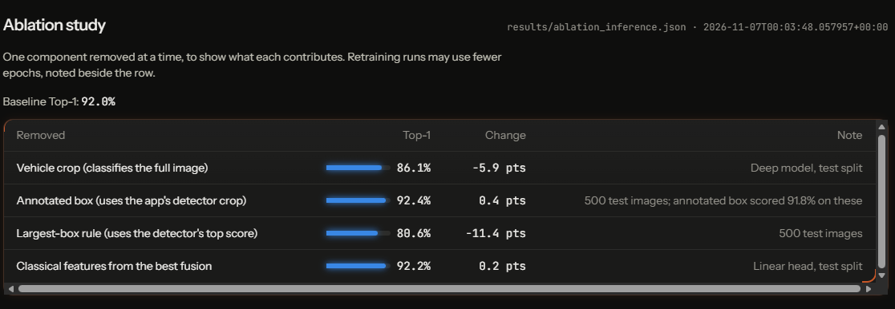

*Research Lab, ablation study. Each row removes or swaps one component of the pipeline and shows the Top-1 and the change against the baseline.*

## Deployment and serving footprint

Live: https://apex3d-xvuc.onrender.com. Render free plan, Docker (lean image). Render's own limits (512 MB memory, small share of one CPU, no disk, sleeps after about 15 minutes idle) are from memory and were not checked.

Measured on the development laptop (Windows 11, Python 3.11). Not Render's hardware.

| Server configuration | Memory after start-up | Memory at peak | Time per recognition | How measured |
|---|---|---|---|---|
| PyTorch detector (before) | 577 MB | 816 MB | 1.00 to 1.30 s | fresh clone of GitHub, real server, memory read with Windows counters |
| ONNX detector, PyTorch and trimesh blocked | 207 MB | 257 MB | 0.64 to 1.10 s | real server code run in-process with torch, torchvision and trimesh unimportable (scripts/measure_lean_server.py) |
| ONNX detector, serve-only environment (requirements-serve.txt, PyTorch not installed) | 213 MB | 395 MB | 0.91 to 1.63 s | real uvicorn server in a brand-new virtual environment, memory read with Windows counters |

The detector was moved from PyTorch to ONNX Runtime (the same network, exported by `scripts/export_detector_onnx.py`) and the classifier's preprocessing from torchvision to NumPy and Pillow, so the server no longer loads PyTorch. That cut memory at start-up from 577 MB to 207 MB and at peak from 816 MB to 257 MB, which is what lets it fit a 512 MB host.

3D mesh builder (TripoSR on CPU), one mesh:

| CPU threads | Time | Whole-server memory at peak | Note |
|---|---|---|---|
| 16 | 247 s (4.1 min) | 1249 MB | whole server, sampled every 6 s |
| 2 | 287 s (4.8 min) | 1057 MB | whole server, sampled every 2 s |

Online: off. TripoSR needs about 1.25 GB while building a mesh, more than the free plan's memory, so the live site shows the showcase car and says the builder is off.

The ONNX detector is not bit-identical to PyTorch. On 200 random test photos (`scripts/check_detector_onnx.py`):

| Measure | PyTorch detector | ONNX detector |
|---|---|---|
| Mean IoU with the true box | 0.9209 | 0.9200 |
| Photos classified correctly | 189 of 200 | 188 of 200 |
| Photos with no box found | 1 | 1 |

The chosen box matches the PyTorch box with a mean IoU of 0.9968 (lowest 0.871; 92.96% of photos at IoU 0.99 or better), and 199 of 200 photos get the same final car class. The detector figures in sections 2 and 3 were measured with the PyTorch detector.

## Failure cases

### Detector and classical-ROI failures

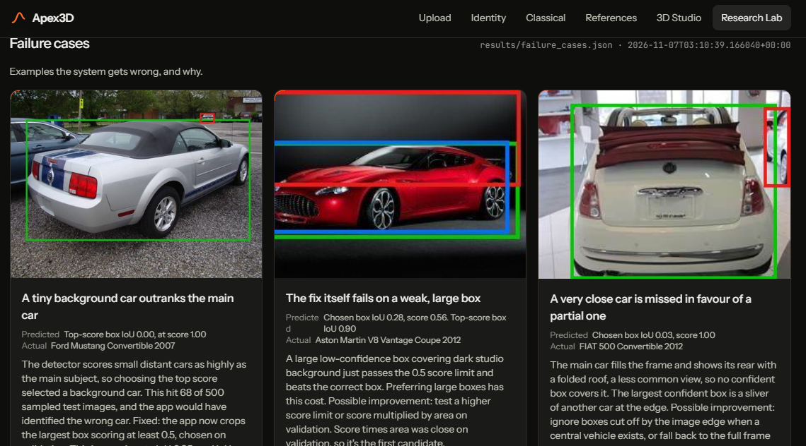

*Research Lab, failure cases. Three detector failures with the photo, the box each method chose, and the cause: a tiny background car outranks the main Ford Mustang (top-score box IoU 0.00), a large low-confidence box beats the right box on an Aston Martin V8 Vantage (chosen box IoU 0.28), and a very close FIAT 500 seen from behind is missed in favour of a sliver of another car (IoU 0.03).*

| Case | Result | Cause |
|---|---|---|
| A tiny background car outranks the main car | Top-score box IoU 0.00, at score 1.00 (true: Ford Mustang Convertible 2007) | The detector scores small distant cars as highly as the main subject, so choosing the top score selected a background car. This hit 68 of 500 sampled test images, and the app would have identified the wrong car. Fixed: the app now crops the largest box scoring at least 0.5, chosen on validation. This image rises to IoU 0.95, and IoU failures fall to 4 of 500. |
| The fix itself fails on a weak, large box | Chosen box IoU 0.28, score 0.56. Top-score box IoU 0.90 (true: Aston Martin V8 Vantage Coupe 2012) | A large low-confidence box covering dark studio background just passes the 0.5 score limit and beats the correct box. Preferring large boxes has this cost. Possible improvement: test a higher score limit or score multiplied by area on validation. Score times area was close on validation, so it's the first candidate. |
| A very close car is missed in favour of a partial one | Chosen box IoU 0.03, score 1.00 (true: FIAT 500 Convertible 2012) | The main car fills the frame and shows its rear with a folded roof, a less common view, so no confident box covers it. The largest confident box is a sliver of another car at the edge. Possible improvement: ignore boxes cut off by the image edge when a central vehicle exists, or fall back to the full frame when the chosen box is narrow. |
| Raised doors fall outside the detector's box | Chosen box IoU 0.59, score 1.00 (true: Spyker C8 Coupe 2009) | COCO training images rarely show scissor doors, so the box covers only the body, while the annotation includes the raised doors. The Ford GT example behaves the same way. The car's body stays in the crop, and detector crops overall didn't measurably lower accuracy on the test sample (see results/detector_crop_accuracy.json), but this specific case wasn't measured separately. Retraining the detector on Stanford boxes could address it. |
| The classical ROI locks onto the background | Contour ROI IoU 0.00. Detector IoU 0.95 (true: BMW ActiveHybrid 5 Sedan 2012) | The largest-contour method assumes the car has the strongest outline. Here the bridge does, so the ROI misses the car completely. It has no idea what a car is. This is why the app crops with the detector. The contour ROI stays as a visual explanation in the classical view, and isn't used for classification. |

### Classifier failures (deployed model, real test set)

642 of 8,041 test images were wrong: 6.39% same manufacturer and model with a different year, 55.92% same manufacturer with a different model, 37.69% a different manufacturer. 196 errors still had at least 90% confidence.

The cases below are the most confident wrong answers, picked to show distinct causes. They are not a random sample.

| Case | True label | Model's answer | Cause |
|---|---|---|---|
| A Jeep Compass is called a Grand Cherokee | Jeep Compass SUV 2012 | Jeep Grand Cherokee SUV 2012 | The photo shows a black SUV with Jeep's seven-slot grille, which to us looks like a Grand Cherokee, not a Compass. If that is right, the model is correct and the dataset label is wrong. We cannot check the label independently, so it counts as an error here, but it is probably label noise. Measured: the model gave Jeep Grand Cherokee SUV 2012 with 100.0% calibrated confidence, and gave the correct class 0.00%. |
| Two vans that are the same vehicle with different badges | Chevrolet Express Cargo Van 2007 | GMC Savana Van 2012 | The Chevrolet Express and the GMC Savana are the same van with different badges. This photo shows a GMC badge on the grille, so the model's answer matches what is visible and the label names the twin model. Cause: twin vehicles, so the label is ambiguous. Measured: the model gave GMC Savana Van 2012 with 100.0% calibrated confidence, and gave the correct class 0.00%. |
| An Audi TT and an Audi TT RS in a blurred photo | Audi TT Hatchback 2011 | Audi TT RS Coupe 2012 | The TT and the TT RS differ mostly in trim details such as the grille, bumpers and wheels, and this photo is motion-blurred, which removes those details. The model chose the RS coupe, the closest class of the same model. Cause: a fine trim difference, made worse by blur. The label also names a different year. Measured: the model gave Audi TT RS Coupe 2012 with 100.0% calibrated confidence, and gave the correct class 0.00%. |
| An Aston Martin V8 Vantage seen only from behind | Aston Martin V8 Vantage Coupe 2012 | Aston Martin Virage Coupe 2012 | This is a studio view from the rear three-quarter, which hides the front grille and air intakes that separate the models. Both the V8 Vantage and the Virage are low, long-bonnet Aston Martin coupes. Cause: the viewpoint hides the features that tell the models apart. Measured: the model gave Aston Martin Virage Coupe 2012 with 100.0% calibrated confidence, and gave the correct class 0.00%. |
| A Silverado 1500 and a Silverado 2500HD | Chevrolet Silverado 1500 Regular Cab 2012 | Chevrolet Silverado 2500HD Regular Cab 2012 | Both are Silverado regular cab pickups with the same cab and body. They differ in payload class and small details, which are hard to see from the side. Cause: near-identical models that differ by capacity, not by shape. Measured: the model gave Chevrolet Silverado 2500HD Regular Cab 2012 with 100.0% calibrated confidence, and gave the correct class 0.02%. |
| A large 'SOLD' sticker over the windscreen | Chevrolet Express Cargo Van 2007 | Chevrolet Express Van 2007 | A big 'SOLD' overlay covers part of the windscreen, and the dataset has two near-identical Express classes (Cargo Van and Van, both 2007). The model answered with the other Express class, so manufacturer, model and year were right and only the variant differed. Cause: the overlay hides detail, and the two classes look alike. Measured: the model gave Chevrolet Express Van 2007 with 100.0% calibrated confidence, and gave the correct class 0.00%. |

Full write-ups with images: `docs/FAILURE_ANALYSIS.md`, `docs/CLASSIFIER_FAILURES.md`.

## The application

Screenshots of the running app. A screen recording of the same flow is in `docs/demo/demo.mp4`.

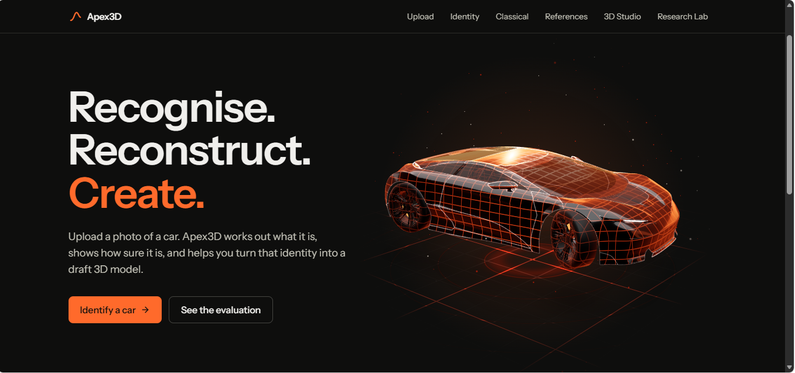

*Landing page. The headline, the two ways in (Identify a car, See the evaluation) and the 3D car that opens the app.*

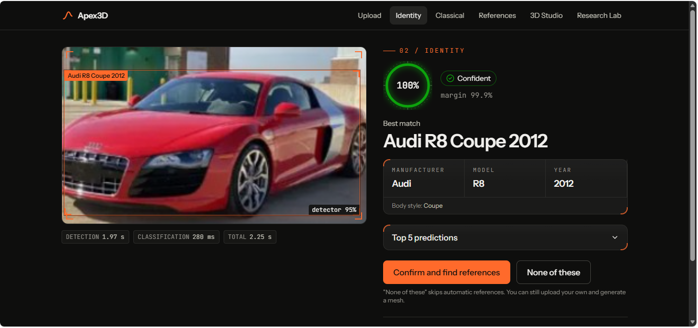

*Identity page for a red Audi R8. The detector box (95%) and the classifier's answer sit on the photo. The right side gives the confidence ring (100%, margin 99.9%, state Confident), the Manufacturer, Model and Year as separate fields, and buttons to confirm or reject. Timings: detection 1.97 s, classification 280 ms, total 2.25 s.*

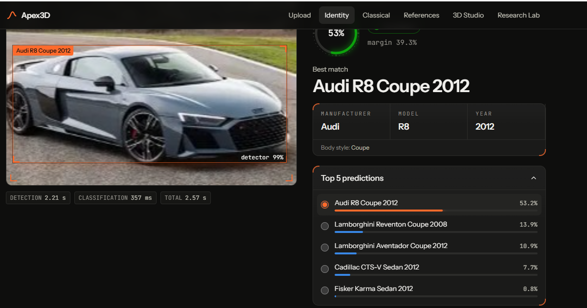

*A second Audi R8 photo, a harder case. The model answers Audi R8 Coupe 2012 at 53.2% with a 39.3% lead over the runner-up, just above the app's 0.52 confidence threshold. The Top 5 list shows what it considered: two Lamborghini coupes (13.9% and 10.9%), then two sedans (7.7% and 0.8%). The detector found the car with 99% confidence. Timings: detection 2.21 s, classification 357 ms, total 2.57 s.*

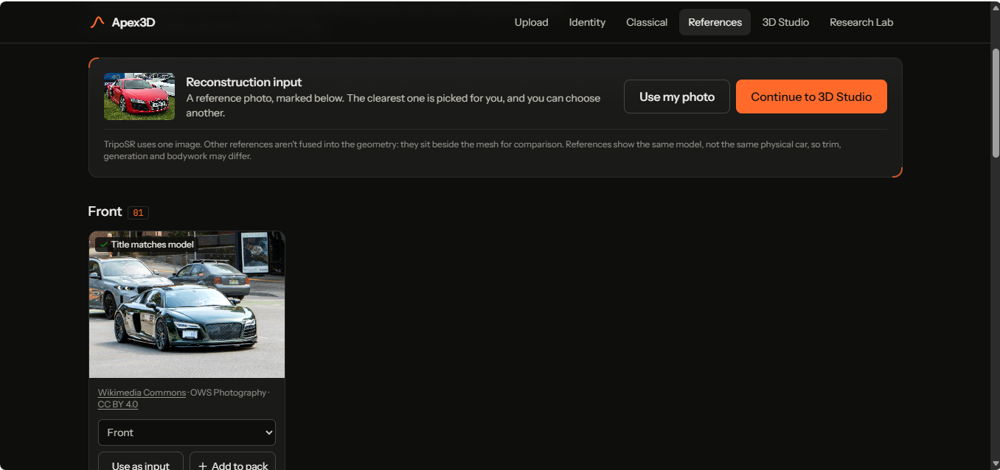

*Reference Studio. After the user confirms the car, the app lists reference photos of that exact model (here a front view from Wikimedia Commons, CC BY 4.0, flagged 'Title matches model'). The clearest one is picked as the reconstruction input, and the user can switch to their own photo or continue to the 3D Studio.*

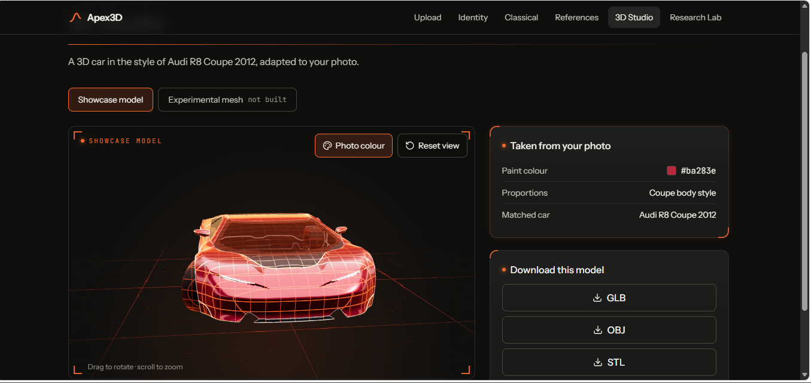

*3D Studio, showcase model. A 3D car in the style of the matched car (Audi R8 Coupe 2012), painted with the colour taken from the photo (#ba283e) and given coupe proportions. It can be downloaded as GLB, OBJ or STL. The Experimental mesh tab reads 'not built' until the user asks for it.*

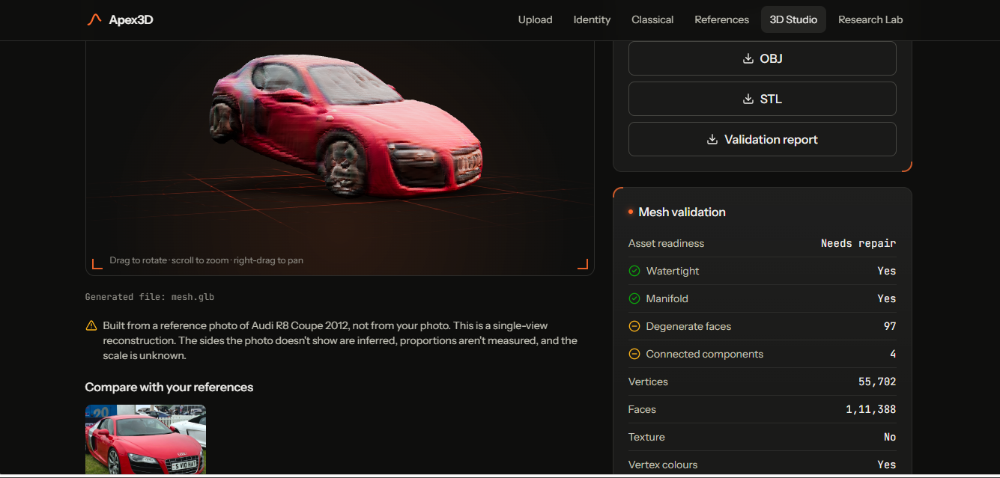

*3D Studio, experimental mesh. TripoSR rebuilt a rough mesh from one reference photo. The validation panel is measured on the file: watertight and manifold, but 97 degenerate faces and 4 connected components, so asset readiness is 'Needs repair'. The page warns that the unseen sides are inferred and the scale is unknown.*
