# Hackathon Technical Solution Report

| Field | Details |
| :--- | :--- |
| **Problem ID** | P5 |
| **Problem Title** | Intelligent Fine-Grained Vehicle Recognition and Analysis System |
| **Team Name** | NoharaFam |
| **Team Members** | Sinchana R Kambar (1RUA24CSE0461); Sohini Dutta (1RUA24CSE0467); Shreyas Muniraju Kolar (1RUA24CSE0445); Shubanck Prasoon Guptha (1RUA24CSE0453) |
| **GitHub Repository** | https://github.com/sinchanaa23/Apex3D , commit evaluated: <!-- AUTO:commit -->`0e3a14a`<!-- /AUTO --> |
| **Live Demo / Deployment** | https://apex3d-xvuc.onrender.com (Render, free plan) |

---

## 1. Problem Understanding & Solution Strategy

* **Core Technical Challenge:** The task is to find the car in a photo and name its manufacturer, model and year, among 196 classes of the Stanford Cars dataset. The hard part is that many classes differ only in small details: of the deep model's mistakes, 63.5% are another model from the same manufacturer, and make-level accuracy is 97.2% while exact-class accuracy is about 92%. The system also has to cope with changes in light, viewing angle, partial occlusion and image resolution, with photos that show a car outside the 196 classes, and with photos that contain several cars, where the detector can pick the wrong one (a tiny background car outranked the main car on 68 of 500 sampled test images before the selection rule was fixed). The constraints we set were practical: an answer in about a second on a CPU, a model small enough for a free host (the server needs about 260 MB), and honest confidence, so that a weak answer is shown as weak.
* **Proposed Methodology:** The system detects the vehicle with a Faster R-CNN, crops it, and classifies the crop with a fine-tuned ConvNeXt-Tiny whose probabilities are calibrated, and a confidence rule turns the result into one of three states (confident, ambiguous, rejected) that change what the user must do. A classical computer-vision pipeline (CLAHE, edges, contours, colour, texture and geometry features) is built as a baseline and as an inspectable analysis view, and we measured it against the deep model and against a fusion of the two. We chose the detect-then-classify design over a single static model because cropping to the car lifts accuracy from 86.1% (whole image) to about 92%, and we chose a calibrated confidence rule over a bare Top-1 label because a closed-set classifier always answers, even for a car it has never seen. As an extension, the app also builds a 3D model for the identified car.

---

## 2. Technical Architecture & Implementation

> *Reference repository modules; do not paste code.*

The app is a React frontend and a FastAPI backend served from one process. A user signs up, uploads a photo, and gets the identity page; from there they can inspect the classical stages, see licensed reference photos of the identified model, and open the 3D Studio. Everything except the landing page needs a login.

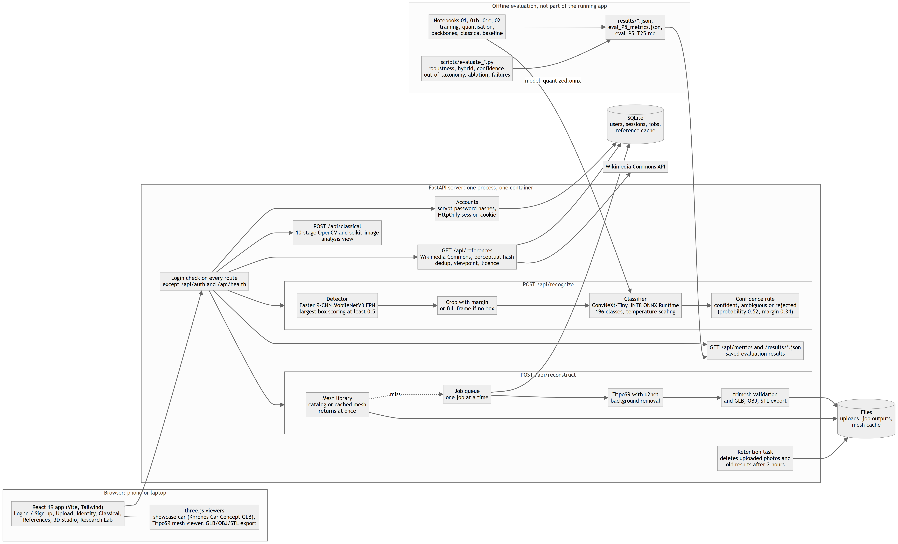

*System architecture: the browser app, the login check, the recognition path (detector, crop, classifier, confidence rule), the classical analysis view, reference retrieval, the 3D pipeline, and the offline evaluation that produces the saved results.*

Main modules: `backend/services/detector_service.py` (detector), `backend/services/classifier_service.py` and `backend/recognition/onnx_classifier.py` (classifier), `backend/classical_cv/pipeline.py` (classical stages), `backend/services/retrieval_service.py` (references), `backend/services/reconstruction_service.py` and `backend/reconstruction/` (3D), `backend/auth.py` (accounts), `frontend/src/` (interface). The full diagram and the data the server keeps are in `docs/ARCHITECTURE.md`.

### 2.1 Classical Algorithmic Baseline

* **Algorithms Utilized:** The pipeline (`backend/classical_cv/pipeline.py`) normalises the image, applies CLAHE contrast enhancement, finds edges with Canny, takes the largest contour as a region of interest, and extracts colour (HSV histograms), texture (local binary patterns), shape (HOG) and 12 geometric features (aspect ratio, area fractions, edge density and Hu moments). It produces ten inspectable stage images that the app shows on its Classical page. A linear SVM on these features is the classical baseline: 17.32% Top-1 and 36.81% Top-5 on the 8,041 test images. On validation, HOG was the strongest single family (14.40%) and all families together reached 16.78%.
* **Adaptive Selection Logic:** The parameters come from the image itself and not from fixed values. The Canny thresholds are computed from the image's median brightness (low and high limits at 67% and 133% of the median), and the contour region of interest has to cover a minimum fraction of the frame. CLAHE works on the lightness channel with a clip limit of 2.0 and an 8 by 8 grid; the Classical page always shows that stage, while for the features an adaptive rule applies it only when the mean luminance is below 70 out of 255. Applying CLAHE adaptively changed classical validation accuracy by -0.33 points, so it was left off for the baseline. As a locator, the contour region of interest is weak: it reaches a mean IoU of 0.642 with the true box against 0.564 for returning the whole image, and it covered at least 90% of the frame on 34.2% of images. That is why the app crops with the detector.

### 2.2 Deep Learning Pipeline

* **Model Architecture:** Classification uses ConvNeXt-Tiny (`convnext_tiny.fb_in22k_ft_in1k` from timm, 28.0 M parameters, 224 px input), pretrained on ImageNet-22k and fine-tuned. We chose it by training three backbones with the same split, crops, augmentation and schedule (`notebooks/01c_baseline_models.ipynb`): ConvNeXt-Tiny reached 92.20% Top-1, EfficientNetV2-S 87.13% and ResNet-50 81.58%. Detection uses torchvision's Faster R-CNN with a MobileNetV3-Large FPN backbone and COCO weights, not retrained; it keeps the car, motorcycle, bus and truck classes. When a photo has several cars, the app uses the largest box scoring at least 0.5. On a random sample of 500 test photos this rule gave a mean IoU of 0.916 with the true box and 92.4% classification accuracy, while choosing the top-scoring box gave 80.6%.
* **Loss Functions & Training:** The loss is cross-entropy with label smoothing 0.1. Training has two stages (`notebooks/01_classifier_training.ipynb`): 2 epochs of the new head alone, then fine-tuning of the whole network for up to 30 epochs (32 epochs run, best at epoch 28), with learning rates 0.001 and 0.0003, layer-wise decay 0.9, weight decay 0.05, mixed precision, and an effective batch of 64. Augmentation is random resized crop (scale 0.6 to 1), horizontal flip, RandAugment and random erasing. The data is Stanford Cars: 6,922 training, 1,222 validation and 8,041 test images, with the ground-truth box plus an 8% margin as input; the test set was used only for reporting. Training ran on an RTX 3050 laptop GPU. The model's probabilities were then calibrated with a temperature of 0.617 fitted on validation, which reduced calibration error (ECE) from 0.208 to 0.034 on validation and from 0.175 to 0.023 on test. Finally the model was quantised for deployment (see 3.1).

### 2.3 Hybrid Integration & Adaptive Mechanism

* **Fusion Strategy:** Classical and deep methods meet in three places. The detector's box is the region of interest that feeds the classifier; the classical stages are shown beside the deep result so a user can inspect what an edge or texture view sees; and we tested a true feature-level fusion, in which the classical geometry features are joined to the deep model's embedding and given to a linear head. Validation chose geometry as the best classical addition, but the fusion did not help: 92.09% Top-1 against 92.18% for the deep features alone on test. We therefore left the fusion out of the live path and report the result as measured.
* **Decision Logic:** The deployed model's calibrated probabilities pass through a rule chosen on validation: if the top probability is at least 0.52 and leads the runner-up by at least 0.34, the answer is confident; below 0.52 it is rejected; otherwise it is ambiguous. On the test set the confident state held 93.5% of images and was right 95.0% of the time, the ambiguous state 1.3% (59.8% right), and the rejected state 5.2% (49.2% right). The interface follows the state: a confident result needs one tap, while an ambiguous or rejected one makes the user pick the class, so a weak guess cannot pass unnoticed. If no car is detected the app classifies the whole frame and says so.

---

## 3. Experimental Benchmarks & Evaluation

### 3.1 Quantitative Benchmarks

<!-- AUTO:table-main -->
| Approach / Model Variant | Top-1 Accuracy | Top-5 Accuracy | Macro F1 | Latency (ms / image, CPU) | Model size (MB) |
| :--- | :---: | :---: | :---: | :---: | :---: |
| **Classical baseline** (HSV, LBP, HOG, geometry + linear SVM) | 17.32% | 36.81% | 15.85% | 14.8 | 2.5 |
| **Deep learning only** (ConvNeXt-Tiny, deployed onnx_int8_static_matmul) | 92.18% | 98.51% | 92.08% | 19.4 | 34.6 |
| **Hybrid** (deep features + classical geometry features, `deep_plus_geometry`) | 92.09% | 97.60% | 91.95% | 22.6 | 35.8 |
<!-- /AUTO -->

* **Analysis:** The deep model is about five times more accurate than the classical baseline (92.18% against 17.32% Top-1) at similar speed, 19.4 ms against 14.8 ms per image on a CPU, so the extra model size (34.6 MB against 2.5 MB) buys a large accuracy gain. The hybrid adds time (22.6 ms) and size (35.8 MB) for a slightly lower accuracy (92.09%), so in our experiments the fusion has a cost and no benefit. Quantisation kept the deep model's accuracy (92.20% before, 92.18% after) while cutting its size from 112 MB to 34.6 MB and its CPU time from 49.2 ms to 19.4 ms; quantising every layer instead of only the matrix multiplications cost 6.1 points. Timings come from different laptops, not from phones.

Additional measured tables.

**Model optimisation (size and speed)**

<!-- AUTO:table-efficiency -->
| Variant | Size (MB) | CPU latency (ms, batch 1) | Test Top-1 |
| :--- | :---: | :---: | :---: |
| pytorch_fp32 | 112.0 | 49.2 | 92.20% |
| onnx_fp32 | 112.0 | 34.3 | 92.20% |
| onnx_fp16 | 56.0 | 38.6 | 92.19% |
| onnx_int8_dynamic | 28.4 | 151.3 | 91.98% |
| onnx_int8_static_all | 28.7 | 21.6 | 86.11% |
| onnx_int8_static_matmul (deployed) | 34.6 | 19.4 | 92.18% |
<!-- /AUTO -->

**Robustness to illumination, blur, noise, resolution and occlusion**

<!-- AUTO:table-robustness -->
Measured on 1000 randomly sampled test images; clean deep Top-1 on that sample is 91.80%.

| Condition | Level | Deep Top-1 | Classical Top-1 |
| :--- | :---: | :---: | :---: |
| brightness | 1.5 | 90.70% | 11.10% |
| brightness | 2.0 | 90.10% | 8.60% |
| brightness | 2.5 | 87.60% | 7.10% |
| low_light | 0.6 | 89.40% | 11.60% |
| low_light | 0.35 | 87.50% | 8.20% |
| low_light | 0.15 | 79.00% | 4.10% |
| blur | 1.0 | 90.70% | 14.60% |
| blur | 2.5 | 79.70% | 9.20% |
| blur | 5.0 | 52.70% | 5.90% |
| noise | 15.0 | 91.30% | 13.00% |
| noise | 35.0 | 88.50% | 9.50% |
| noise | 60.0 | 82.60% | 6.20% |
| low_resolution | 128 | 85.10% | 10.70% |
| low_resolution | 64 | 51.50% | 6.20% |
| low_resolution | 32 | 9.00% | 2.20% |
| occlusion | 0.1 | 88.00% | 7.90% |
| occlusion | 0.25 | 79.30% | 2.70% |
| occlusion | 0.4 | 60.70% | 0.90% |
<!-- /AUTO -->

The deep model is steady under changes of brightness and noise, and loses most to heavy blur, very low resolution and large occlusion. The classical baseline is far lower in every condition.

**Confidence and rejection**

<!-- AUTO:table-confidence -->
Thresholds chosen on validation: confident at probability >= 0.52 with margin >= 0.34, rejected below 0.52.

| App state | Share of test images | Accuracy |
| :--- | :---: | :---: |
| confident | 93.52% | 95.04% |
| ambiguous | 1.27% | 59.80% |
| rejected | 5.21% | 49.16% |
<!-- /AUTO -->

**Photos outside the 196 classes**

<!-- AUTO:table-oot -->
| Photos | Images | Rejected | Ambiguous | Confident |
| :--- | :---: | :---: | :---: | :---: |
| Other vehicles (airplanes, motorbikes, helicopters, boats) | 412 | 91.5% | 0.0% | 8.5% |
| Other things (animals, objects, scenes) | 600 | 98.3% | 0.0% | 1.7% |
| Stanford Cars photos (in the 196 classes), uncropped | 1200 | 12.3% | 1.3% | 86.3% |

AUROC for separating in-class from outside photos by top probability: 0.977.
<!-- /AUTO -->

### 3.2 Visual Outputs & Intermediate Representations

**Classical stages (intermediate states).** The ten stage images the classical pipeline produces for one photo: original, CLAHE, edges, contour region of interest, crop, three HSV channels, LBP texture and HOG.


**Identity result.** The detector's box, the predicted manufacturer, model and year as separate fields, the confidence ring with its state, and the timings.

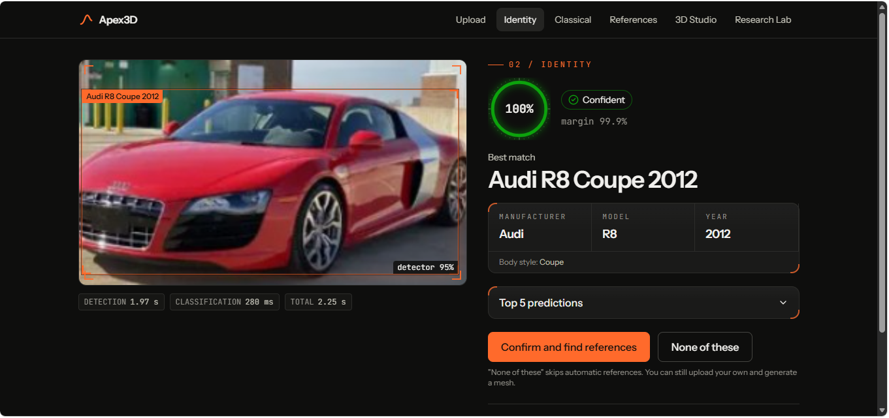

**A harder case, with the Top-5 list.** The model answers Audi R8 Coupe 2012 at 53.2% with a 39.3% lead, just above the confidence threshold; the next candidates are two Lamborghini coupes.

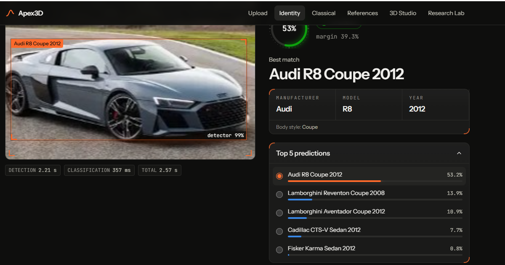

**Training and calibration.**


**Coverage against accuracy.** Raising the confidence threshold lowers coverage and raises accuracy on the images kept; the line marks the threshold the app uses.

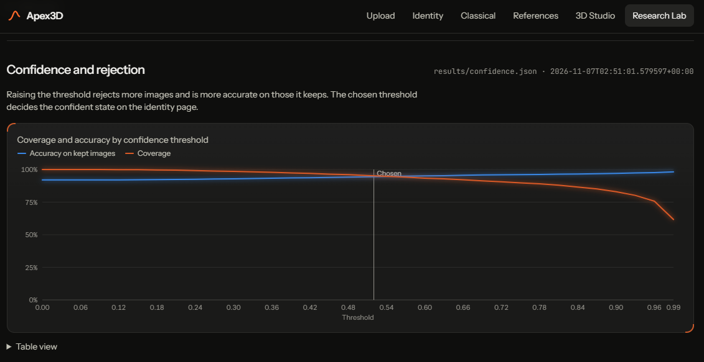

**Backbone comparison.**


**Robustness charts.**

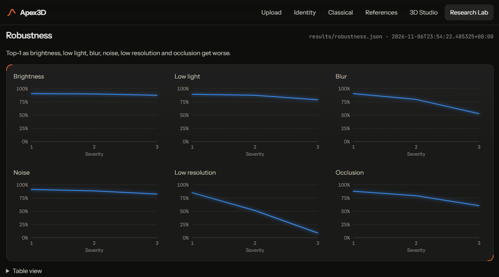

**Reference photos and 3D.** After the user confirms the car, the app finds Creative-Commons reference photos of that model with their licence and author, then opens the 3D Studio, which shows a designed showcase car painted with the colour taken from the photo.

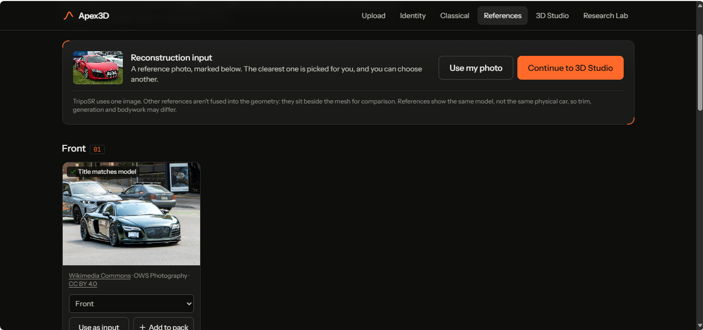

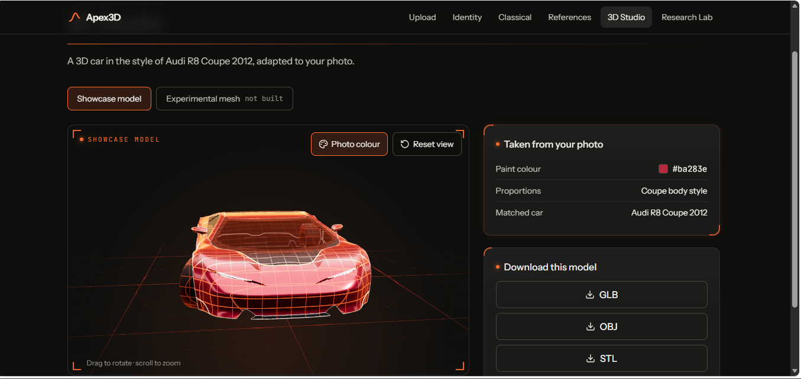

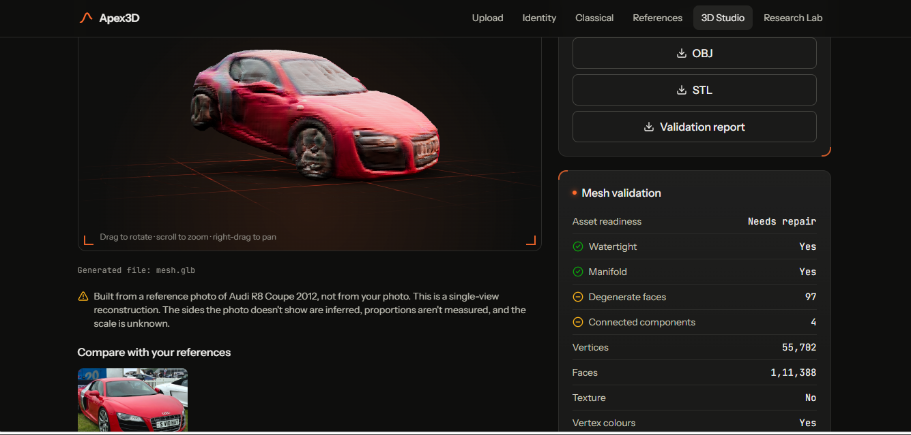

### 3.3 Ablation Study

<!-- AUTO:table-ablation -->
| Component changed | Test Top-1 | Change vs. reference (points) |
| :--- | :---: | :---: |
| Vehicle crop removed (classify the full image) | 86.15% | -5.87 |
| Annotated box replaced by the detector's box (500 test images; annotated box scored 91.8% on them) | 92.40% | +0.60 |
| Detector's box chosen by top score instead of the app's rule (500 images) | 80.60% | -11.20 |
| Classical geometry features removed from the hybrid | 92.18% | +0.09 |
| Backbone: resnet50.a1_in1k instead of ConvNeXt-Tiny | 81.58% | -10.62 |
| Backbone: tf_efficientnetv2_s.in21k_ft_in1k instead of ConvNeXt-Tiny | 87.13% | -5.07 |

Reference for each row: the deployed deep model with annotated-box crops, except the hybrid row, which compares against the hybrid itself.
<!-- /AUTO -->

* The vehicle crop matters most: classifying the whole image instead of the car costs 5.9 points, and picking the detector's highest-scoring box instead of the largest confident one costs 11.2 points, because the top score often belongs to a small background car. Replacing the annotated box with the detector's box did not lower accuracy (92.4% against 91.8% on the same 500 photos), so the detector is good enough for the live path. Removing the classical features from the hybrid changed nothing meaningful (+0.09 points), which is why they are not in the live path. The backbone choice is worth 5 to 10 points.

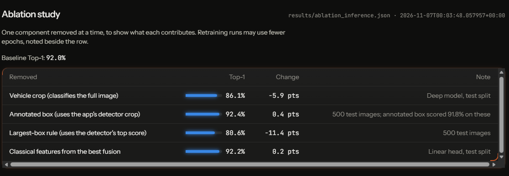

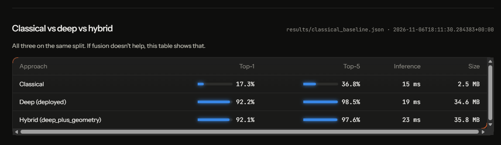

---

## 4. Failure Modes & Limitations

* **Observed Failure Case:** We documented eleven failures (`docs/CLASSIFIER_FAILURES.md`, `docs/FAILURE_ANALYSIS.md`). Three show the main kinds. First, look-alike cars: the model called a Jeep Compass a Grand Cherokee, a Chevrolet Express a GMC Savana (the same van with a different badge) and an Audi TT an Audi TT RS in a blurred photo. Second, the detector picked the wrong car: a tiny background car outranked a Ford Mustang convertible, giving a box with an IoU of 0.00 with the true one. Third, the whole system degrades when the photo is poor: Top-1 falls to 52.7% under heavy blur, 51.5% at 64 px and 9.0% at 32 px.
* **Root Cause & Mitigation:** Look-alike errors come from classes that differ only in trim, badge or year, which a 224 px crop may not show; they are the largest group (63.5% of errors are within one manufacturer, and 196 of the 642 errors still had at least 90% confidence), so "confident" is right 95.0% of the time, not always. One of the most confident errors looks like a wrong dataset label, which we could not check independently. The mitigation we built is the three-state rule and the Top-5 list that lets the user correct the answer. The detector error came from taking the highest score, which favours small, sharp background cars; choosing the largest confident box fixed most cases (from 80.6% to 92.4%), but a large low-confidence box can still win, and a very close car seen from behind can be missed. A higher score limit or a score-times-area rule is the next thing to test. For poor photos, a super-resolution step or blur-aware training augmentation would be the next steps; adaptive CLAHE did not help in low light (79.0% without it and 76.8% with it at the darkest level).

Measured facts about the classifier's failures:

<!-- AUTO:table-failures -->
The deployed model was wrong on 642 of 8,041 test images; 196 of those errors had confidence of at least 90%.

| Case | True label | Model's answer | Confidence | Probability of the true class |
| :--- | :---: | :---: | :---: | :---: |
| A Jeep Compass is called a Grand Cherokee | Jeep Compass SUV 2012 | Jeep Grand Cherokee SUV 2012 | 100.0% | 0.00% |
| Two vans that are the same vehicle with different badges | Chevrolet Express Cargo Van 2007 | GMC Savana Van 2012 | 100.0% | 0.00% |
| An Audi TT and an Audi TT RS in a blurred photo | Audi TT Hatchback 2011 | Audi TT RS Coupe 2012 | 100.0% | 0.00% |
| An Aston Martin V8 Vantage seen only from behind | Aston Martin V8 Vantage Coupe 2012 | Aston Martin Virage Coupe 2012 | 100.0% | 0.00% |
| A Silverado 1500 and a Silverado 2500HD | Chevrolet Silverado 1500 Regular Cab 2012 | Chevrolet Silverado 2500HD Regular Cab 2012 | 100.0% | 0.02% |
| A large 'SOLD' sticker over the windscreen | Chevrolet Express Cargo Van 2007 | Chevrolet Express Van 2007 | 100.0% | 0.00% |

The cases are the most confident wrong answers, picked to show different causes; they are not a random sample. Causes are for the team to write.
<!-- /AUTO -->

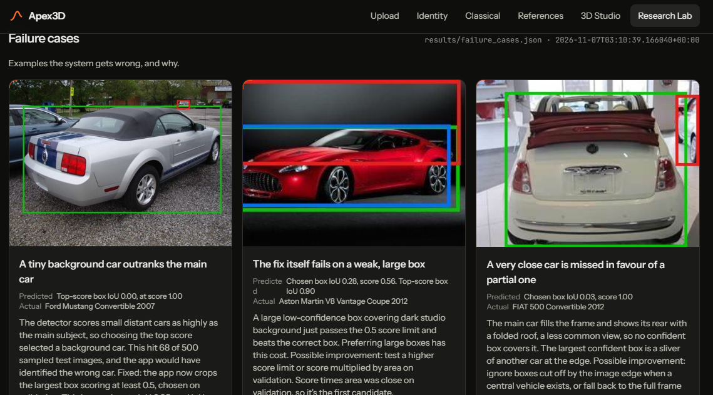

* **Limitations and ethics:**
  * **Closed set.** The model knows 196 cars up to 2012 and always answers with one of them. On Caltech-101 photos the rule rejected 91.5% of other vehicles and 98.3% of other things, but still gave a confident wrong answer for 8.5% and 1.7%. That test contains no newer cars, so it does not measure the likeliest real case, a modern car.
  * **How far the numbers go.** The headline accuracy uses the dataset's boxes; with the detector's box it was measured on a random sample of 500 photos. The robustness test used 1,000 sampled photos and synthetic corruptions. Detector mAP is understated because the dataset marks one car per image. Timings are from laptops, not phones. The live app uses the detector as an ONNX file, which is not bit-identical to PyTorch: on 200 test photos its chosen box overlaps PyTorch's with a mean IoU of 0.997, 199 of 200 photos get the same car, and 188 against 189 are correct.
  * **3D.** TripoSR builds a mesh from one photo, so unseen sides are guessed and the scale is unknown; a mesh takes about 4 to 5 minutes on a CPU and our example was flagged "Needs repair". The mesh builder is off on the live site because it needs about 1.25 GB of memory, more than the free plan has; the live 3D Studio shows the showcase car, which is one generic model recoloured and re-proportioned, not a copy of the car.
  * **Privacy.** Photos can show people and number plates; the app never reads plates and identifies make, model and year only. A photo sent for recognition is held in memory and not saved. A photo sent for a 3D build, or uploaded as a reference, is deleted automatically after 2 hours. The server asks Wikimedia Commons for references by class name and never sends it user photos. Accounts keep a name, an email and a salted scrypt password hash; there is no email verification, so anyone can sign up with any address. Writing this found that no cleanup had been running, so 38 photos had piled up during development; automatic deletion was added.
  * **Licences and fairness.** References carry their Creative-Commons licence and author; the showcase car (Khronos Car Concept) is CC BY 4.0 and is credited in the app. The repository includes eleven Stanford Cars test photos as failure examples, which should be removed if the dataset's terms require it. The model is least reliable on near-identical models and on cars outside 1990 to 2012; we did not analyse accuracy by region or manufacturer group, so we cannot say it is equally good for all.
  * **Hosting.** The live site runs on a free plan: it sleeps when idle (the first visit then takes about a minute), has no disk so accounts are lost when it restarts, and has a small share of a CPU, so it is slower than the laptop figures. We tested the live site only from outside (health, access rules), not under load.

---

## 5. Deployment & Quickstart Guide

### Quickstart Commands

```bash
# 1. Clone the repository and install the dependencies
git clone https://github.com/sinchanaa23/Apex3D
cd Apex3D
pip install -r requirements.txt
# 2. Build the frontend once, then start the app and open http://localhost:8000 (sign up on first use)
cd frontend && npm ci && npm run build && cd ..
python start_server.py
```

We ran these commands on a fresh clone with Python 3.11 and Node 22. The evaluation tables are regenerated with `python scripts/build_app_metrics.py` and `python scripts/build_eval_report.py` from the files in `results/`; the individual experiments are `scripts/evaluate_deployed_model.py`, `scripts/evaluate_out_of_taxonomy.py`, `scripts/measure_hybrid_cost.py` and `scripts/check_detector_onnx.py`, and they need the dataset prepared by `scripts/prepare_dataset.py`. The 3D mesh builder is optional and is set up with `scripts/setup_triposr.ps1`.

### Deployment Format

* The app is a single Docker container (React frontend and FastAPI backend) that runs on the CPU. The classifier and the detector both run with ONNX Runtime; the detector is exported from torchvision during the image build, so the server does not need PyTorch and uses about 210 to 260 MB in steady use (207 MB after start-up and 257 MB at its peak in one measurement; 395 MB at the peak by Windows' peak counter in a fresh serve-only environment). It is deployed on Render's free plan at https://apex3d-xvuc.onrender.com, with login required for everything except the landing page, and the lean image leaves out the TripoSR mesh builder. A fuller image with the mesh builder (`deploy/Dockerfile.full`) is for a host with at least 2 GB of memory. Details are in `docs/DEPLOY_RENDER.md` and `eval_P5_T25.md`.

---

## AI Assistance Declaration

AI assistance was used heavily in this project and in this report. The AI assistant Claude (Anthropic), used through Claude Code, helped to build the React frontend, the FastAPI integration and login system, the evaluation scripts that measured the deployed model, the metric and report builders, the deployment files and the repository documentation. It also drafted the text of this report from the repository's measured results. Every number and table in this report comes from the result files in the repository (`results/`, `eval_P5_metrics.json`, `eval_P5_T25.md`) and not from the AI's memory. The first draft of the prose in sections 1, 2, 4 and 5 was AI-written. The team is responsible for the content, and the share of the text that is AI-written should be read as the draft's share (all of the prose) reduced by any rewriting the team did before submitting.

---

### Student Submission Checklist

- [ ] Working GitHub repository link included with an updated `README.md`.
- [ ] No raw code pasted into this report.
- [ ] All table metrics match test runs reproducible via the repository.
- [ ] All team member details accurately recorded.
- [ ] AI assistance declared, and the AI share of this report is at most 30%.
