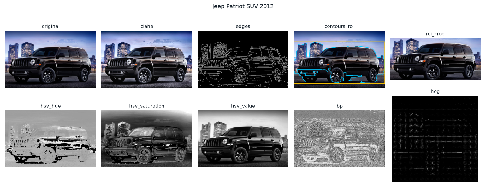
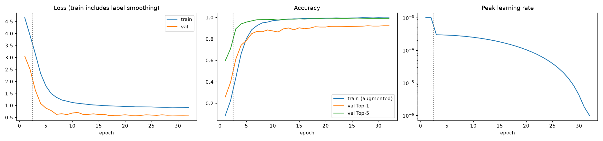
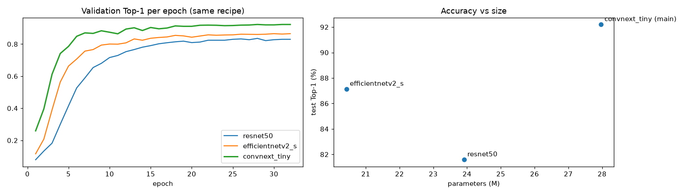
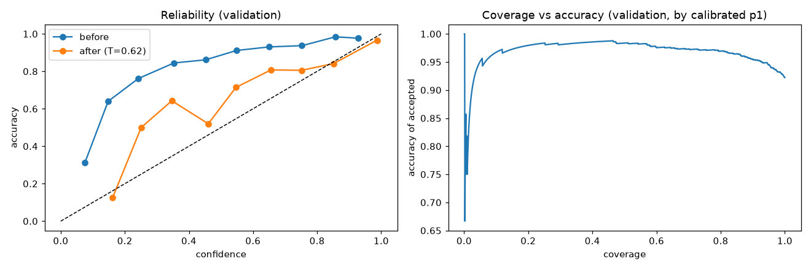

# Hackathon Technical Solution Report

| Field | Details |
| :--- | :--- |
| **Problem ID** | P5 |
| **Problem Title** | Intelligent Fine-Grained Vehicle Recognition and Analysis System |
| **Team Name** | NoharaFam |
| **Team Members** | Sinchana R Kambar (1RUA24CSE0461); Sohini Dutta (1RUA24CSE0467); Shreyas Muniraju Kolar (1RUA24CSE0445); Shubanck Prasoon Guptha (1RUA24CSE0453) |
| **GitHub Repository** | https://github.com/sinchanaa23/Apex3D , commit evaluated: <!-- AUTO:commit -->`d29635c`<!-- /AUTO --> |
| **Live Demo / Deployment** | https://apex3d-xvuc.onrender.com (Render, free plan) |

---

## 1. Problem Understanding & Solution Strategy

* **Core Technical Challenge:** [WRITE: the main technical barrier and the failure modes you targeted, with the constraints you worked under]
* **Proposed Methodology:** [WRITE: 2 to 3 sentences on your end-to-end strategy and why you chose it over a single static model]

---

## 2. Technical Architecture & Implementation

> *Reference repository modules; do not paste code. Module map: see report/FACTS_SHEET.md.*

### 2.1 Classical Algorithmic Baseline

* **Algorithms Utilized:** [WRITE]
* **Adaptive Selection Logic:** [WRITE]

### 2.2 Deep Learning Pipeline

* **Model Architecture:** [WRITE: the model you chose and why]
* **Loss Functions & Training:** [WRITE: loss, schedule, augmentation and data used]

### 2.3 Hybrid Integration & Adaptive Mechanism

* **Fusion Strategy:** [WRITE: how the classical and deep parts connect]
* **Decision Logic:** [WRITE: how the system decides between a confident answer, an ambiguous one and a rejection]

---

## 3. Experimental Benchmarks & Evaluation

### 3.1 Quantitative Benchmarks

<!-- AUTO:table-main -->
| Approach / Model Variant | Top-1 Accuracy | Top-5 Accuracy | Macro F1 | Latency (ms / image, CPU) | Model size (MB) |
| :--- | :---: | :---: | :---: | :---: | :---: |
| **Classical baseline** (HSV, LBP, HOG, geometry + linear SVM) | 17.32% | 36.81% | 15.85% | 14.8 | 2.5 |
| **Deep learning only** (ConvNeXt-Tiny, deployed onnx_int8_static_matmul) | 92.18% | 98.51% | 92.08% | 19.4 | 34.6 |
| **Hybrid** (deep features + classical geometry features, `deep_plus_geometry`) | 92.09% | 97.60% | 91.95% | 22.6 | 35.8 |
<!-- /AUTO -->

* **Analysis:** [WRITE: 2 to 3 sentences on the trade-offs between accuracy and speed that the table shows]

Additional measured tables (delete any you do not need):

**Model optimisation (size and speed)**

<!-- AUTO:table-efficiency -->
| Variant | Size (MB) | CPU latency (ms, batch 1) | Test Top-1 |
| :--- | :---: | :---: | :---: |
| pytorch_fp32 | 112.0 | 49.2 | 92.20% |
| onnx_fp32 | 112.0 | 34.3 | 92.20% |
| onnx_fp16 | 56.0 | 38.6 | 92.19% |
| onnx_int8_dynamic | 28.4 | 151.3 | 91.98% |
| onnx_int8_static_all | 28.7 | 21.6 | 86.11% |
| onnx_int8_static_matmul (deployed) | 34.6 | 19.4 | 92.18% |
<!-- /AUTO -->

**Robustness to illumination, blur, noise, resolution and occlusion**

<!-- AUTO:table-robustness -->
Measured on 1000 randomly sampled test images; clean deep Top-1 on that sample is 91.80%.

| Condition | Level | Deep Top-1 | Classical Top-1 |
| :--- | :---: | :---: | :---: |
| brightness | 1.5 | 90.70% | 11.10% |
| brightness | 2.0 | 90.10% | 8.60% |
| brightness | 2.5 | 87.60% | 7.10% |
| low_light | 0.6 | 89.40% | 11.60% |
| low_light | 0.35 | 87.50% | 8.20% |
| low_light | 0.15 | 79.00% | 4.10% |
| blur | 1.0 | 90.70% | 14.60% |
| blur | 2.5 | 79.70% | 9.20% |
| blur | 5.0 | 52.70% | 5.90% |
| noise | 15.0 | 91.30% | 13.00% |
| noise | 35.0 | 88.50% | 9.50% |
| noise | 60.0 | 82.60% | 6.20% |
| low_resolution | 128 | 85.10% | 10.70% |
| low_resolution | 64 | 51.50% | 6.20% |
| low_resolution | 32 | 9.00% | 2.20% |
| occlusion | 0.1 | 88.00% | 7.90% |
| occlusion | 0.25 | 79.30% | 2.70% |
| occlusion | 0.4 | 60.70% | 0.90% |
<!-- /AUTO -->

**Confidence and rejection**

<!-- AUTO:table-confidence -->
Thresholds chosen on validation: confident at probability >= 0.52 with margin >= 0.34, rejected below 0.52.

| App state | Share of test images | Accuracy |
| :--- | :---: | :---: |
| confident | 93.52% | 95.04% |
| ambiguous | 1.27% | 59.80% |
| rejected | 5.21% | 49.16% |
<!-- /AUTO -->

**Photos outside the 196 classes**

<!-- AUTO:table-oot -->
| Photos | Images | Rejected | Ambiguous | Confident |
| :--- | :---: | :---: | :---: | :---: |
| Other vehicles (airplanes, motorbikes, helicopters, boats) | 412 | 91.5% | 0.0% | 8.5% |
| Other things (animals, objects, scenes) | 600 | 98.3% | 0.0% | 1.7% |
| Stanford Cars photos (in the 196 classes), uncropped | 1200 | 12.3% | 1.3% | 86.3% |

AUROC for separating in-class from outside photos by top probability: 0.977.
<!-- /AUTO -->

### 3.2 Visual Outputs & Intermediate Representations



*[WRITE: one line saying what this figure shows]*



*[WRITE: one line saying what this figure shows]*



*[WRITE: one line saying what this figure shows]*



*[WRITE: one line saying what this figure shows]*


*[WRITE: one line saying what this figure shows]*


*[WRITE: one line saying what this figure shows]*

### 3.3 Ablation Study

<!-- AUTO:table-ablation -->
| Component changed | Test Top-1 | Change vs. reference (points) |
| :--- | :---: | :---: |
| Vehicle crop removed (classify the full image) | 86.15% | -5.87 |
| Annotated box replaced by the detector's box (500 test images; annotated box scored 91.8% on them) | 92.40% | +0.60 |
| Detector's box chosen by top score instead of the app's rule (500 images) | 80.60% | -11.20 |
| Classical geometry features removed from the hybrid | 92.18% | +0.09 |
| Backbone: resnet50.a1_in1k instead of ConvNeXt-Tiny | 81.58% | -10.62 |
| Backbone: tf_efficientnetv2_s.in21k_ft_in1k instead of ConvNeXt-Tiny | 87.13% | -5.07 |

Reference for each row: the deployed deep model with annotated-box crops, except the hybrid row, which compares against the hybrid itself.
<!-- /AUTO -->

* [WRITE: what the ablation shows about each component]

---

## 4. Failure Modes & Limitations

* **Observed Failure Case:** [WRITE: at least one scenario where the system went wrong]
* **Root Cause & Mitigation:** [WRITE: why it happened and what you would change]

Measured facts about the failures:

<!-- AUTO:table-failures -->
The deployed model was wrong on 642 of 8,041 test images; 196 of those errors had confidence of at least 90%.

| Case | True label | Model's answer | Confidence | Probability of the true class |
| :--- | :---: | :---: | :---: | :---: |
| A Jeep Compass is called a Grand Cherokee | Jeep Compass SUV 2012 | Jeep Grand Cherokee SUV 2012 | 100.0% | 0.00% |
| Two vans that are the same vehicle with different badges | Chevrolet Express Cargo Van 2007 | GMC Savana Van 2012 | 100.0% | 0.00% |
| An Audi TT and an Audi TT RS in a blurred photo | Audi TT Hatchback 2011 | Audi TT RS Coupe 2012 | 100.0% | 0.00% |
| An Aston Martin V8 Vantage seen only from behind | Aston Martin V8 Vantage Coupe 2012 | Aston Martin Virage Coupe 2012 | 100.0% | 0.00% |
| A Silverado 1500 and a Silverado 2500HD | Chevrolet Silverado 1500 Regular Cab 2012 | Chevrolet Silverado 2500HD Regular Cab 2012 | 100.0% | 0.02% |
| A large 'SOLD' sticker over the windscreen | Chevrolet Express Cargo Van 2007 | Chevrolet Express Van 2007 | 100.0% | 0.00% |

The cases are the most confident wrong answers, picked to show different causes; they are not a random sample. Causes are for the team to write.
<!-- /AUTO -->

* **Limitations and ethics:** [WRITE: the limits of the evaluation and of the system, and the ethical points: photos uploaded by users, accounts with unverified emails, label noise in the dataset, the dataset's age and coverage]

---

## 5. Deployment & Quickstart Guide

### Quickstart Commands

```bash
# 1. Clone the repository and install the dependencies
git clone https://github.com/sinchanaa23/Apex3D
cd Apex3D
pip install -r requirements.txt
# 2. Build the frontend once, then start the app and open http://localhost:8000 (sign up on first use)
cd frontend && npm ci && npm run build && cd ..
python start_server.py
```

[TODO: run these commands on a clean clone and correct them before submitting]

### Deployment Format

* [WRITE: how the app is packaged and where it runs (Docker image, ONNX runtime, the live URL)]

---

## AI Assistance Declaration

[WRITE: state honestly which parts of the project and of this report AI tools helped with, which tools, and your estimate of the share of this report's text that is AI-written. The policy allows AI help with system design if declared, and caps AI content in the report at 30%.]

Facts the team can build the declaration from: Claude (Anthropic), used through Claude Code, was used on this repository for the React frontend, the FastAPI integration and login system, the evaluation scripts that measured the deployed model, the metric and report builders, the deployment files and the repository documentation. [TODO: add what each other member used, and which parts were done without AI]

---

### Student Submission Checklist

- [ ] Working GitHub repository link included with an updated `README.md`.
- [ ] No raw code pasted into this report.
- [ ] All table metrics match test runs reproducible via the repository.
- [ ] All team member details accurately recorded.
- [ ] AI assistance declared, and the AI share of this report is at most 30%.
